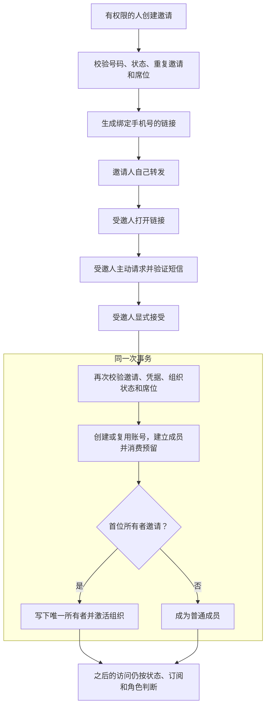

# PRD：Webman 可复用 B2B SaaS 基座

## 1. 文档控制

### 1.1 文档信息

| 项目 | 内容 |
|---|---|
| 产品 | Webman 可复用 B2B SaaS 基座 |
| 文档位置 | GitHub Issue #1，标签 ready-for-agent |
| 读者 | 产品、设计、开发、测试 |
| 适用范围 | 独立部署、面向中国大陆移动号码的 Webman B2B SaaS |
| 文档状态 | 需求已确认。本文不是实现、部署或测试通过的证明 |
| 整理日期 | 2026-11-18 |
| 负责人与计划日期 | 未指定，本文不推定 |

### 1.2 修订记录

| 日期 | 变更 | 对行为的影响 |
|---|---|---|
| 2026-11-18 | 确认 Q1–Q44、Q-A、Q-B、Q-C1–Q-C14 | 形成当前业务规则 |
| 2026-11-18 | 按评审结构重整章节，统一用词，把错误码收成独立契约 | 不新增、不放宽、不删除已确认行为 |
| 2026-11-18 | 修订邮箱恢复、更换邮箱、公开发码响应及错误码适用范围 | 补充 AC-01、AC-02、AC-04、AC-25、AC-27 的验收条件 |
| 2026-11-18 | 明确普通成员邀请的鉴权顺序，补齐账号安全短信验收 | AC-27 验证满额时的拒绝原因；AC-08–AC-10 覆盖更换邮箱时使用的短信 |
| 2026-11-18 | 将最小可运行示例用作新产品的项目模板 | D2 由另一名开发者从干净环境按文档开通两个组织，通过 HTTP 验证业务记录隔离 |
| 2026-11-18 | 将模板项目包的发布纳入 D2 | 首个及后续产品均通过 `composer create-project` 创建，D2 使用发布版本验收 |
| 2026-11-18 | 确定 D2 产品模板采用官方 `walkor/webman` v2.2.3 骨架 | 发布派生项目包，使用非交互建项命令安装必需依赖，并在生成的项目中验证双组织隔离 |

### 1.3 编号

| 前缀 | 含义 | 是否单独代表优先级 |
|---|---|---|
| FR | 功能需求。子编号是同一能力下的规则 | 否 |
| NFR | 安全与数据约束 | 否 |
| INT | 包、运行环境和接入契约 | 否 |
| AC | 验收场景 | 否 |
| US-01–US-71 | 原用户故事，正文在第 14 章，原文不改 | 否 |
| US-72–US-85 | 审查补充故事，已纳入 FR，不得挪出本期 | 否 |
| D1–D4 | 交付顺序 | 只表示先后，不表示可以砍掉后面阶段 |
| Q-A、Q-B、Q-C | 已关闭的决策，解释见第 13 章 | 否 |

P0 只保留在少数标题上，表示该规则曾经被单列确认。它不高于同章其他条款。

### 1.4 评审时怎么读

| 角色 | 先看 | 目的 |
|---|---|---|
| 产品 | 第 2–6 章 | 确认范围、角色、状态和主流程 |
| 设计 | 第 4 章、FR-04、FR-07.05 | 本期没有完整前端。需要设计的是邀请页字段和成员列表可见信息 |
| 开发 | 第 7–9 章 | 按功能需求实现，按第 8 章返回错误，按第 9 章接入 |
| 测试 | 第 10 章，用第 12 章对覆盖 | 验收以真实 HTTP、MySQL、Redis 为准 |

冲突时以第 7 章为准。流程表、决策记录和用户故事都不能单独开出一条新规则。

### 1.5 用词

全文按下面的词使用。后文不再混用近义词。

| 词 | 含义 | 不要写成 |
|---|---|---|
| 中国大陆移动号码 | 通过 FR-01.02 校验的号码。存储为 E.164 | 只写「有 +86 前缀的号码」 |
| 账号 | 一个产品内的一个人 | 用户、会员混用 |
| 员工账号 | 可以不属于任何组织的账号，仅供平台管理 | 内部用户、超管 |
| 组织 | 租户。必须有名称 | 租户、公司混用而不定义 |
| 正常运行 | 已激活、未停用、未归档。这是组合称呼，不是第四个状态值 | 单独的状态枚举 |
| 普通成员 | 三种固定角色里的「成员」 | 普通用户 |
| 有效邀请 | 未过期、未撤销、未消费、未被替换 | 未使用邀请 |
| 席位占用 | 当前成员数 + 有效待接受邀请数 | 只算已加入的人 |
| 业务项目 | 安装本基座的那个可运行产品 | 宿主、租户 |

## 2. 背景与目标

### 2.1 背景

维护者要为多个独立的 B2B SaaS 复用身份、组织、成员、权限、订阅访问和管理能力。各产品仍要自己掌握业务功能和基础设施。

webman-starter 目前是 Composer 库，已有统一 API 响应、分页、Trace ID、错误码、业务异常和 Webman 异常处理。它还没有可运行的 SaaS 应用，也没有账号、组织、成员、订阅、持久化集成和自动化测试。仓库里的 JWT、短信和迁移依赖可以复用，不代表这些产品能力已经完成。

没有这层基座时，每个产品都会各自处理跨租户访问、权限迟迟不失效、席位被并发打超、邀请被重放、订阅到期后行为不一致，以及管理操作没有审计。

### 2.2 目标

- 多个独立产品复用同一套账号、组织、权限、订阅和管理能力。
- 产品之间账号隔离；同一产品内租户隔离，权限在下一次请求就失效。
- 业务项目通过后端 API、示例、文档和自动化验收接入，而不是复制一套实现。
- 覆盖已确认的人工开通、邀请加入、订阅管理和运营恢复。

做到即可认为目标达成：业务项目不必再自建上述能力；第 10 章的验收可以由真实 HTTP 和真实 MySQL、Redis 重复执行。本文不另设访问量或收入指标。

### 2.3 非目标

- 前端、管理后台或某个垂直行业的完整产品。
- 公众自建组织、没有邀请就凭短信注册、跨产品 SSO、共享账号中心。
- 企业 SSO、扫码或社交登录。国际号码、海外产品和邮箱优先的身份策略。海外方案另立项，不能直接改本版入口。
- 自定义组织角色、租户自己改权限映射、权限编辑器。
- 在线支付、自动计费、开票和财务核算。
- 订单、存储、AI 调用等产品自己的额度。本期额度只有组织席位。
- 多 ORM、多数据库、每租户独立库、每租户私有部署。
- 平台管理员冒用成员，或自动获得业务数据权限。
- 物理删除组织数据。卸载包时删除数据。安装或升级 Composer 时自动改表。
- 停用或归档时暂停订阅计时。自动补偿天数。改套餐模板就悄悄改变已有订阅。降级时自动移除成员。
- 任意业务表导出。业务数据导出由业务项目按同一套租户和权限规则自己做。
- 把基座当成对外销售的开发平台所需的商业分发能力。
- 未经验证的性能、协程安全、供应商真正送达、生产可用性承诺。
- 账号注销、个人数据主体导出、个人信息留存期限和删除权。本期只保证审计和日志不记录完整凭据与完整手机号。
- 所有者或成员修改组织名称。

## 3. 产品范围

### 3.1 产品定义

本基座是面向国内产品的 Composer 包。业务项目负责安装、配置基础设施、显式启用 API，并实现自己的业务。基座负责任职身份、组织、权限、席位、订阅访问和管理审计。

租户是组织，允许只有一个人的组织。一个产品内，一个账号可以加入多个组织。不同业务项目的账号、组织和订阅互不相通。

租户数据放在共享的 MySQL 库和共享表中，每条租户记录带组织归属。业务项目必须调用基座的隔离和权限检查，基座不能替业务项目拦下绕过契约的任意 SQL。

### 3.2 本期交付

后端 API：身份认证，手机号换绑与恢复，账号资料，邮箱与密码，短信和邮件限额，带名称的组织，邀请，成员关系，三种固定角色，平台管理，无组织员工账号，人工订阅，席位，管理审计，CSV 导出，封闭错误码。

同时交付：版本化迁移，配置示例，初始化命令，受控恢复命令，D2 基于 `walkor/webman` v2.2.3 发布的产品模板项目包（兼作最小可运行示例），API 文档，接入说明，自动化验收。

US-01–US-85 全部在本期。交付顺序是 D1 身份与会话、D2 组织与邀请、D3 订阅与生命周期、D4 审计导出与文档。D1 加 D2 完成后，就可以接一个手动开通的多租户业务。D3 和 D4 仍必须做，只是排在后面。

### 3.3 市场与身份边界

手机号按 E.164 存储。邀请、登录、换绑、恢复和平台初始化都只接受中国大陆移动号码，规则见 FR-01.02。不提供可配置的邮箱优先策略。

默认登录是手机号加短信验证码。邮箱不能用来注册，也不能用来接受邀请。登录后可以绑定并验证邮箱、设置密码，作为同一个账号的备用登录。

邀请由系统生成链接，交给有权限的人自己转发。基座不发邀请短信或邮件。

## 4. 角色与权限

不增加新角色。平台管理资格和组织角色相互独立，有其中一个不自动获得另一个。

### 4.1 角色

| 角色 | 可以做什么 | 边界 |
|---|---|---|
| 产品开发者 | 安装配置、启用 API、声明业务权限、做邀请页和业务功能 | 必须接入租户隔离。基座不提供完整前端 |
| 部署运维 | 显式迁移、初始化首位平台管理员、唯一管理员的离线恢复 | 离线恢复不是日常管理接口 |
| 平台管理员 | 授予和撤销平台资格、建立员工账号、开通组织、改组织名称、管套餐和订阅、停用和解除停用、归档和恢复、停用或归档时撤销邀请、人工恢复账号、查平台审计 | 不冒用成员，不看、不导出成员完整联系方式，不能撤销最后一位平台管理员 |
| 组织所有者 | 任免管理员，管理邀请和成员，发起或撤销所有权转移，在未停用时归档，查看并导出本组织审计和受限联系方式 | 退出前必须先转移所有权。不能改组织名称。停用或归档期间不能做组织侧操作 |
| 组织管理员 | 邀请和移除普通成员，查看并导出受限联系方式 | 不能任免管理员，不能处置所有者，不能看仅限所有者的组织审计。停用或归档期间不能操作 |
| 普通成员 | 按授权使用业务，维护自己的资料，看成员的显示名称和角色，退出组织 | 不能看受限联系方式 |
| 受邀人 | 打开邀请链接，验证指定手机号，显式接受 | 邀请凭据不能调用组织和平台 API。没有有效邀请不能注册 |

### 4.2 谁可以发起

本表只回答「谁有资格发起」。组织停用、归档和订阅是否还允许该操作，以 FR-09.06 为准。本表不放宽 FR-09.06。

| 操作 | 可以发起的人 | 主要限制 |
|---|---|---|
| 初始化首位平台管理员 | 运维，经服务器命令 | 已有任何有效平台资格时拒绝，包括尚未首次登录 |
| 建立员工账号并授予平台资格 | 平台管理员 | 不加入组织，不发邀请短信，不是公众注册 |
| 撤销平台资格 | 平台管理员，可以撤自己 | 不能使有效平台管理员变为 0 |
| 开通组织 | 平台管理员 | 必填名称、未停用套餐、合法订阅窗口 |
| 修改组织名称 | 平台管理员 | 停用和归档期间也可以 |
| 创建、修改、停用套餐模板 | 平台管理员 | 不停用已售出的快照；不物理删除 |
| 调整订阅日期或更换套餐 | 平台管理员 | 席位会超则拒绝，不自动移除成员 |
| 停用、解除停用 | 平台管理员 | 解除停用不恢复邀请，不改订阅，不激活组织 |
| 归档 | 平台管理员；未停用时还包括所有者 | 已停用时所有者不能归档 |
| 从归档恢复 | 平台管理员 | 回到归档前的激活阶段，并保留停用标记 |
| 取消尚未激活的开通 | 平台管理员 | 变为归档，邀请失效，席位释放 |
| 管理首位所有者邀请 | 平台管理员 | 仅待激活且未停用、未归档。订阅已到期时不能获取、重签或改号 |
| 停用或归档期间撤销邀请 | 平台管理员 | 用来释放席位，不必先解除停用 |
| 邀请普通成员 | 所有者、管理员 | 只能授予成员。已激活、未停用、未归档且订阅有效，并有席位 |
| 重新获取链接 | 原操作权限的人 | 不延期、不新增席位、不发短信 |
| 接受邀请 | 受邀人 | 必须验证目标手机号。已经登录也不能跳过 |
| 任免管理员 | 所有者 | 不能通过邀请直接任命 |
| 移除普通成员 | 所有者、管理员 | 不删除全局账号，不影响其他组织 |
| 退出组织 | 管理员、普通成员；所有者须先转移 | 停用和归档期间不可以 |
| 发起、撤销所有权转移 | 所有者 | 请求 7 天有效 |
| 接受所有权转移 | 被指定的本组织成员 | 接受时再次复核；过期或撤销不改变所有者 |
| 查看或导出受限联系方式 | 所有者、管理员 | 平台管理员不可以 |
| 查看或导出本组织审计 | 所有者 | 平台管理员走平台审计，不冒用成员 |
| 维护本人资料、登录、换绑 | 账号本人 | 不因某个组织停用而不可用 |
| 平台人工恢复手机号 | 平台管理员 | 必须有可追溯的归属核验 |
| 唯一平台管理员离线恢复 | 运维，经服务器命令 | 不能用初始化命令或公开 HTTP 代替 |

### 4.3 组织侧请求如何被拒绝

组织侧 API 按这个顺序只返回第一个错误：身份无效；不是该组织成员或资源不存在则 `not_found`；已归档；已停用；然后才是待激活、订阅时间和角色。完整表和例外在 FR-09.06。

平台 API 先检查平台资格，不要求操作者是组织成员，但仍然不能返回成员的完整联系方式。

全局登录、本人资料、换绑、邮箱和密码不走组织侧这套拒绝顺序。

## 5. 领域模型

### 5.1 术语

| 术语 | 定义 |
|---|---|
| 业务项目 | 独立部署的 Webman 产品。它安装本包，配置基础设施，实现自己的业务 |
| 账号 | 产品范围内的一个身份。主标识是已验证的中国大陆移动号码。已验证邮箱是可选的附加标识，两种方式进入同一个账号。换绑只换标识，不换账号 ID，也不改已有成员关系 |
| 显示名称 | 账号持有人自己填写的可选名称。未填时显示「未设置姓名」，不从手机号或邮箱推断 |
| 组织名称 | 开通时必填，1–100 个 Unicode 字符，产品内不必唯一。只有平台管理员可改 |
| 成员关系 | 账号在一个组织中的角色。离开一个组织不影响其他组织，也不删除账号 |
| 平台管理员 | 产品级管理资格，与组织角色分开 |
| 套餐 | 可复用模板。本期只有名称和席位数 |
| 订阅 | 一个组织当前的一条记录：套餐快照、生效时间、到期时间。不并行保存下一段订阅 |
| 席位占用 | 成员数与有效待接受邀请数之和，含首位所有者邀请。接受邀请是把预留转成成员，不另占一席 |
| 邀请链接 | 进入加入流程的链接，由邀请人自己转发 |
| 重新获取邀请链接 | 再次取得同一有效邀请的原链接。不延期、不发通知、不新占席位 |
| 重新签发 | 作废旧邀请和它的验证凭据，经席位检查后生成新的 7 天邀请 |
| 变更首位所有者受邀手机号 | 平台为待激活组织更换邀请目标号码。新邀请仍然只产生所有者 |
| 所有权转移请求 | 所有者发起、对方确认的待办。7 天有效，发起人可撤销 |
| 短信验证码重发 | 只用于身份验证，与转发邀请链接无关 |
| 登录发码 | 只有号码已有账号，或存在指向该号码的有效邀请时，才真正提交短信供应商。成功响应不体现是否下发 |

### 5.2 组织状态

组织不是「待激活 / 正常运行 / 停用 / 归档」四选一。同时保存三项：

| 项 | 取值 | 规则 |
|---|---|---|
| 激活阶段 | 待激活，或已激活 | 待激活没有所有者，所有权由邀请代表。已激活恰好一位所有者。接受首位所有者邀请时，在同一事务里变成已激活 |
| 平台停用 | 是或否 | 可与任一激活阶段并存。解除停用不改激活阶段、订阅和已撤销的邀请 |
| 归档 | 是或否 | 进入归档时记下当时的激活阶段和停用标记。恢复时按所记返回，停用标记保留 |

因此「待激活且停用」「已激活且停用」「已激活、停用且已归档」都合法。只存一个状态字段无法正确恢复。

| 激活 | 停用 | 归档 | 成员侧 | 平台还要记住的事 |
|---|---|---|---|---|
| 待激活 | 否 | 否 | 只能验证并接受首位所有者邀请，且订阅未到期 | 可改号、重签、取消开通 |
| 待激活 | 是 | 否 | 不能接受邀请 | 先解除停用，才能再签发 |
| 已激活 | 否 | 否 | 再按订阅时间和角色，见 FR-09.06。此组合称为正常运行 | 可停用、可归档 |
| 已激活 | 是 | 否 | 组织侧操作全部拒绝 | 可撤销邀请、解除停用、归档 |
| 归档前的值 | 归档前的值 | 是 | 组织侧操作全部拒绝 | 恢复后激活阶段和停用与归档前一致 |

停用和归档不暂停、不延长订阅时间。

### 5.3 订阅时间与席位

比较一律用 UTC。输入是带时区的 RFC 3339，精度到秒。不接受没有时区的本地时间。

| 条件 | 订阅状态 |
|---|---|
| 当前时间 < 生效时间 | 未生效 |
| 生效时间 ≤ 当前时间 < 到期时间 | 有效 |
| 当前时间 ≥ 到期时间 | 已到期 |

到期时间必须晚于生效时间。一个组织只有一条当前订阅。把到期时间改到过去，且仍晚于生效时间，会使订阅立即到期。不能预置第二段未来订阅。

席位、邀请消费、换绑清理、套餐变更和所有权转移必须在一个事务里完成。禁止先查再写造成超卖、同一邀请接受两次，或出现两个所有者。席位是否已释放，不得依赖后台清扫任务已经跑过。

套餐额度低于当前席位占用时，拒绝变更，直到成员或邀请先减少。系统不自动移除成员。

同一产品、同一组织、同一 E.164 号码，最多一个有效待接受邀请。这个唯一性检查和席位预留在同一事务里做。

### 5.4 必须保持的不变式

- 一个产品内，一个 E.164 号码最多一个账号；一个已验证邮箱最多属于一个账号。不自动合并。
- 已激活组织恰好一位所有者。待激活组织零位所有者。
- 生产环境创建账号只有两条路：接受有效邀请，或由初始化命令、平台管理员建立员工账号。登录接口不创建账号。
- 租户业务记录必须有组织归属。账号、平台资格和审计中的全局事件不是租户业务记录。
- 要求审计的变更，审计写不进去就整笔拒绝。

## 6. 关键流程

每一步的失败条件和并发要求以第 7 章为准。

| 流程 | 谁来触发 | 结果 |
|---|---|---|
| 首位平台管理员 | 运维；还没有有效平台资格 | 命令写入号码并建立员工账号与资格。首次登录仍要短信验证。并行初始化最多成功一个 |
| 开通组织 | 平台管理员 | 写入名称、套餐和订阅日期，预留一席，返回所有者邀请。对方验证手机号并接受后，账号复用或创建，组织变为已激活。业务是否可用仍看订阅 |
| 成员加入 | 所有者或管理员 | 检查角色、订阅、重复邀请和席位后发链接。接受时把预留变成成员，角色只是成员 |
| 换绑与恢复 | 本人、邮箱恢复或平台人工恢复 | 按路径核验，验证新号码，同一事务更换标识并清理旧邀请。全部会话作废，不自动登录。唯一平台管理员失去全部自助手段时走离线命令 |
| 所有权转移 | 所有者与本组织的接收人 | 接收人在 7 天内从待办确认。成功后原所有者变为管理员，其他待处理请求失效。过期或撤销不改变所有者 |
| 取消开通与恢复归档 | 平台管理员 | 未激活的开通取消后成为归档。恢复后仍是待激活，且保留归档前的停用。已激活组织恢复后保留唯一所有者和成员 |
| 订阅与访问 | 平台改套餐或日期；成员访问组织 | 先看归档和停用，再看订阅，再看角色。停用和归档不冻结订阅时钟 |

邀请加入：

生成、获取和转发链接不发短信或邮件。只打开链接不发验证码、不建账号、不消费邀请、不激活组织。验证码必须由受邀人主动请求。

## 7. 功能需求

本章是行为的唯一正文。第 6 章只作导航。第 10 章用来证明，第 13 章用来说明原因，第 14 章用来追溯。这三处都不增加本章没有写的行为。若表述不一致，以本章为准。

标题里的 P0 是历史确认标记，不是优先级。未标 P0 的条款同样属于本期，不得因没有标记而延期。

### FR-01 账号、登录标识与登录方式
目的：一个产品内，一个人只用一个已验证手机号对应一个账号，并可按需启用邮箱密码。

关联故事：US-14、US-15、US-16、US-17、US-18、US-19、US-20、US-67、US-78。验收：AC-02、AC-12、AC-27。交付：D1；邀请注册在 D2 完成。

#### FR-01.01 登录方式

- 默认使用手机号和短信验证码登录，无须先有邮箱或密码。已登录用户可以选择绑定并验证邮箱、设置密码，启用同一账号的邮箱密码登录和邮件密码重置；未启用该方式的账号不要求设置密码。
- 创建账号只有两条生产路径：接受有效邀请；初始化命令或平台管理员建立员工账号。登录接口不能创建账号。
- 密码为 8–64 个 Unicode 字符，按 UTF-8 计算不得超过 72 字节。不要求大小写、数字或特殊字符。拒绝空字符串、首尾以外的纯空白、控制字符和换行。不记录明文密码。

#### FR-01.02 登录标识与账号归属

- 已验证手机号是账号的默认且唯一主登录标识，按 E.164 规范化后在同一产品内唯一。
- 本期仅接受中国大陆移动号码。校验必须与 libphonenumber 的 CN 元数据一致：能解析为地区 CN、国家码 86，且号码类型为移动号码。拒绝固话、短号、无法解析的输入，以及只带 +86 前缀的非法号码。实现可以选用兼容该元数据的库，验收以该规则为准，不以某一份手写正则为准。
- 邀请、登录、换绑、恢复、初始化和建立员工账号执行相同校验。非法号码返回 phone_invalid，且不调用短信供应商。规范化结果才是 E.164 存储值。
- 手机号登录复用已有账号。受邀新用户必须验证目标手机号并接受有效邀请，才能创建账号及成员关系。没有有效邀请的陌生手机号不能仅凭短信验证码自动注册。
- 可选绑定的已验证邮箱指向同一账号。绑定邮箱不得创建第二个账号；邮箱已属于其他账号时拒绝绑定，不自动合并账号。

#### FR-01.03 邮箱通道

邮箱绑定、更换已验证邮箱、密码重置、邮箱恢复是四种固定用途。业务项目不能新增用途，也不能关闭限额。数量上限和有效期只能收紧。

| 规则 | 默认 |
|---|---|
| 同一产品、同一邮箱、同一用途 | 两次发送至少间隔 60 秒；自然日最多 10 封。自然日时区与短信相同 |
| 同一产品、同一来源 IP、同一邮箱用途 | 每小时最多 20 次，允许上调到不超过 200。与短信 IP 限额分开计数 |
| 一次性验证码或链接 | 10 分钟，单次消费。到期时刻失效 |
| 每个挑战的失败次数 | 默认 5 次。第 5 次错误使挑战失效。规则同短信，配置只能降低 |

- 公开发信先按同一规则校验输入并预占额度。密码重置仅向已启用密码登录的账号的已验证邮箱发信。通过邮箱恢复手机号只要求该邮箱是账号当前的已验证邮箱，未设置密码也可发起。
- 以上两个公开入口通过校验和限额检查后，跳过发送、供应商接受、拒绝或超时均返回 HTTP 200、code=success，message 和 data 统一表示已受理。供应商拒绝和超时分别记入受限审计，不在公开响应中返回。
- 提交前原子预占额度。供应商拒绝或超时不返还额度；已登录的邮箱绑定和更换入口分别返回 email_submission_failed、email_submission_timeout。各入口被限额拦截时均返回 email_rate_limited，且不调用供应商。
- 不把邮件提交成功记为用户已经打开邮件。

#### FR-01.04 更换已验证邮箱与密码登录

- 更换邮箱必须已登录，且账号已经有已验证邮箱。先完成旧邮箱验证或当前手机号的账号安全短信验证，再验证新邮箱。两步凭据都须仍有效。新邮箱已被其他账号使用时返回 email_already_used，不合并账号。
- 更换成功后撤销除当前会话以外的全部会话。不改变账号 ID、手机号、成员关系和平台资格。
- 更换邮箱提交时，旧邮箱此前签发且未用完的密码重置、手机号恢复链接或验证码，以及已经换取的对应验证凭据，同时失效。最终提交密码重置或手机号换绑时，须复核签发时的邮箱绑定仍有效。之后即使换回同一邮箱，旧凭据也不恢复。
- 本期不能把已验证邮箱解绑成「没有备用登录方式」；要换地址，走更换流程。
- 邮箱密码登录连续失败按账号计数，默认 5 次后锁定该登录方式 15 分钟，返回 password_login_locked。锁定期间短信登录仍然可用。未启用密码的账号、邮箱不存在、密码错误，一律返回 credentials_invalid，不锁定不存在的邮箱。
- 重置密码沿用 FR-05，撤销该账号全部会话。重置不自动登录。

### FR-02 短信验证码、发送限额与短期凭据
目的：验证码可被暴力尝试和短信轰炸时仍然可控，且不把提交供应商当成已经送达。

关联故事：US-16、US-30、US-31、US-66、US-77。验收：AC-08、AC-09、AC-10、AC-25、AC-27。交付：D1；邀请联动在 D2 验收。

#### FR-02.01 短信限额（P0）

短信限额属于不可关闭的产品规则。

- 短信的手机号日上限和发送间隔只能收紧，不能关闭。来源 IP 每小时上限默认 20，可配置为 1–200 的整数；高于 200、低于 1 或关闭限流时拒绝加载，返回 rate_limit_config_invalid，不得静默改回默认值。邮件限额见 FR-01.03，两套 IP 计数互不影响。
- 短信用途由服务端固定为四类：登录、邀请验证、换绑、账号安全。邀请验证的重发计入邀请验证；旧号、新号和人工恢复中的新号计入换绑。更换邮箱时验证当前手机号计入账号安全，不得占用换绑额度，也不得用来完成换绑。
- 不得通过自定义用途、切换接口或重新签发邀请绕过限额。
- 生成、重新获取、重新签发或分享邀请链接不调用短信供应商、不占用短信额度、不受短信发送间隔限制，也不得清零或重置已有验证码发送限额。
- 邮箱绑定不发送短信，不占用短信额度。

| 限额维度 | 默认规则 | 计时与边界 |
|---|---|---|
| 同一产品、同一手机号、同一用途 | 两次发送至少间隔 60 秒；自然日最多 10 条 | 自然日按产品配置时区，默认 Asia/Shanghai；达到 10 条后当天拒绝继续发送 |
| 同一产品、同一邀请的短信验证码重发 | 至少间隔 60 秒，且受手机号＋用途及 IP 限额约束 | 仅对有效邀请提供验证；不延长邀请 7 天有效期，验证码仍按独立有效期及挑战规则处理 |
| 同一产品、同一来源 IP、同一用途 | 每小时默认最多 20 次，配置上限 200 | 按连续 60 分钟窗口计算；覆盖失败、超时以及登录入口未真正下发的请求；不能通过换手机号绕过 |
| 登录／邀请验证／换绑／账号安全的短信验证码 | 有效期 5 分钟，单次消费 | 到期时刻即无效；与邀请 7 天有效期独立；业务项目只能缩短有效期 |
| 每个短信验证挑战的校验失败次数 | 默认最多 5 次；第 5 次错误即将该挑战置为失效 | 适用于登录、邀请验证、换绑（含恢复流程的新号验证）和账号安全四种用途；配置只能降低上限，不能关闭 |

#### FR-02.02 限额执行与环境隔离

- 限额必须跨工作进程原子执行，手机号先规范化后参与计数，来源 IP 只能从可信代理配置或真实连接取得，不信任客户端任意转发头。
- 产品时区由业务项目配置，不能通过请求参数改变；同一产品的部署实例共享限额，测试环境与生产环境相互隔离。

#### FR-02.03 验证码校验失败限制（P0）

- 发送限额与校验失败次数分别执行。每个实际签发的短信验证挑战独立记录失败次数，并绑定产品、手机号、用途及本次流程。客户端不能通过生成新挑战 ID 重置计数。
- 默认第 1–4 次错误返回 verification_code_invalid。第 5 次错误原子地使该挑战失效，并返回 verification_attempts_exceeded。失效后，即使输入正确验证码也须拒绝；计数过期或服务进程切换不得使其重新生效。
- 正确验证码仅可在挑战未到期、未消费且未耗尽失败次数时成功消费一次。
- 校验、计数、失效和成功消费须跨进程原子执行，防止并发猜测超过上限，或成功消费与失败次数耗尽产生双重结果。

#### FR-02.04 验证码重试与流程隔离

- 同一挑战的通知重试不得延长验证码有效期或清零失败次数。
- 获得新挑战必须重新经过已有发送限额并使同一验证流程中旧挑战失效；发送限额错误、未知挑战或失败响应不得泄露手机号是否注册。
- 手机号／用途不匹配的请求不能被当作成功验证，也不能改变其他手机号或用途的挑战。
- 记录失败及耗尽结果用于审计，不记录用户提交的验证码。

#### FR-02.05 发送额度预占

- 提交短信供应商前，原子检查并预占号码发送额度与发送间隔。提交失败或超时仍计入发送尝试，不立即返还额度；再次发送仍须通过限额检查。
- 被限额拦截的请求不调用供应商。
- IP 的发送请求计数与号码是否注册无关；错误响应不得泄露号码是否已有账号。
- 登录用途在号码合法时，先按同一套间隔、日额度和 IP 额度预占，再决定是否下发。仅当该号码已有账号，或同一产品内存在指向该号码的有效待接受邀请时，才提交供应商。否则不提交，也不在响应里表示「未发送」。通过校验和限额检查后，跳过发送、供应商接受、拒绝或超时均返回 HTTP 200 和 code=success，message 和 data 统一表示已受理。自动化测试通过测试发送器判断是否下发，不通过响应正文判断。不要求两次响应耗时相同。
- 换绑和恢复的新号在占用短信额度前先做唯一性检查。新号已被其他账号使用时返回 phone_already_used，不向该号码发送验证码。这是已登录或已持有恢复凭据的入口，允许明确冲突，不适用于公开登录入口。

#### FR-02.06 短信错误与投递状态

- 触发限额时，返回 HTTP 429 和 sms_rate_limited。公开登录发码按 FR-02.05 返回已受理，供应商拒绝和超时分别记入受限审计。其他短信用途在供应商明确拒绝时返回 sms_submission_failed，超时且结果不明时返回 sms_submission_timeout。响应均沿用统一错误契约。
- 无论号码是否已注册，公开限流响应须使用相同的业务码、文案和字段结构。
- 供应商接受提交时，只能标记为“已提交”；收到供应商明确的送达结果后，才能标记为“已送达”。没有送达反馈时，保持“提交／未知”状态。

#### FR-02.07 验证码发送失败与邀请状态

- 短信验证码发送超出限额、提交失败或超时均不得视为已送达，也不使有效邀请失效或释放其席位。
- 验证码重发须受限流保护并记录审计，不新增邀请或席位，不延长邀请有效期。
- 邀请过期后不得继续发送用于接受该邀请的验证码，须由有权限的操作者先经过订阅和席位检查重新签发邀请。
- 验证码与短期凭据按用途、账号／手机号及本次流程绑定，不得跨流程使用。
- 邀请链接的生成和获取不依赖短信供应商是否可用。

#### FR-02.08 验证成功后的短期凭据

- 短信验证码按原规则自签发起 5 分钟有效，成功验证后立即消费。
- 短期凭据自验证成功起 10 分钟有效，到期时刻即失效。验证码与短期凭据分别计时，不延长或恢复原验证码的有效期。
- 上述短期凭据规则适用于邀请手机号验证结果、各换绑／恢复路径中的旧号或新号验证结果，以及邮箱恢复核验结果。
- 凭据仅用于绑定的本次流程。邀请接受或手机号换绑成功后，对应凭据立即失效，不得再次使用。
- 请求验证码、重试提交或刷新页面，均不得延长已取得凭据的有效期。后一步验证成功，也不得延长前一步验证结果的有效期。
- 多步流程提交时，所有必需凭据均须仍有效；已过期的验证结果须重新完成对应校验，不能凭后一步结果跳过。
- 关联邀请已过期、撤销或被替换时，对应凭据立即失效，即使尚未满 10 分钟。原有用途、账号／手机号及流程绑定、权限和状态检查继续执行。

### FR-03 手机号换绑与账号恢复
目的：更换主登录标识时保住同一个账号，并按当事人还能证明什么来选择恢复路径。

关联故事：US-17、US-18、US-20、US-24、US-60、US-76。验收：AC-03、AC-04、AC-05、AC-06、AC-10、AC-21、AC-27。交付：D1；与完整邀请 API 的联动在 D2 验收。

#### FR-03.01 正常手机号换绑

- 本路径要求已有普通登录会话。用户先向当前手机号请求换绑验证码；验证通过后，才能向新手机号请求验证码。两个号码均验证通过后，才可提交换绑。
- 邮箱恢复和平台人工恢复分别鉴权，不适用“必须验证旧号”的前置条件。
- 所有路径的新号码均须为有效 +86 手机号，且与当前号码不同。验证凭据须绑定当前账号、当前主手机号、新手机号及本次流程；提交时再次检查有效性和唯一性，不得拼接其他账号或流程的验证结果。

#### FR-03.02 换绑提交与会话撤销

- 在同一事务中更改账号的主登录标识，并使该账号全部旧会话及刷新能力失效，包括组织用途和平台用途。
- 换绑成功后，不直接签发新会话。用户可通过新手机号和短信验证码重新登录；此前已绑定并验证邮箱、设置密码的用户，也可直接使用邮箱密码登录，无须先通过新手机号登录一次。
- 旧手机号不能再登录原账号，已撤销的会话不恢复。
- 换绑不改变账号 ID、组织成员关系、组织角色或平台管理资格。
- 新号码已被本产品其他账号占用时，返回明确冲突并拒绝换绑，不自动合并账号。

#### FR-03.03 换绑后的邀请及凭据清理

- 换绑成功时，同一产品内目标号码等于旧号码的全部未消费邀请失效，不论邀请记录上是否已经写下账号 ID。有效预留席位在同一事务中释放。已经接受的成员关系保留。不得只清理带有该账号 ID 的邀请，否则尚未绑定账号的旧链接仍可被旧号接受。
- 已发出且指向旧号码的短信验证码及其他短信验证凭据立即失效。
- 并发换绑、邀请接受或刷新会话必须遵守这些不变量；提交后旧凭据的逻辑失效不能等待 Redis 后台清理。
- 失败或事务回滚时不得留下部分号码变更、席位释放或成员关系变更。

#### FR-03.04 邮箱恢复：旧手机号不可用，且已绑定并验证邮箱

- 用户通过当前已验证邮箱完成一次性恢复身份校验，再验证新手机号后完成换绑。该账号无须设置密码或启用邮箱密码登录。该路径不要求旧号短信，也不要求已有普通登录会话。
- 不能临时提交未绑定邮箱作为恢复依据。
- 恢复凭据仅用于继续本次换绑，不能直接访问组织或平台数据。
- 完成换绑时，执行相同的唯一性检查、全部会话撤销、旧邀请失效、旧短信凭据失效和审计规则。

#### FR-03.05 平台人工恢复：旧手机号不可用，且未绑定已验证邮箱

- 不提供公众自助通道。平台管理员通过受保护的人工手机号恢复入口处理已有账号，先核验账号归属，再要求申请人验证新手机号。
- API 文档须明确申请／完成入口、平台权限、核验字段和失败行为。处理记录须包含目标账号、原因、工单／核验依据引用及操作者。
- 平台管理员须依据已保存的客户归属资料，通过预先登记的联系人或授权渠道核验。不能仅依据本次申请提供的新手机号；只知道旧号码或能收到新号短信，均不足以通过核验。
- 无法形成可追溯核验依据时，拒绝完成恢复。不得跳过新号验证，也不得指定已被占用的号码。
- 人工恢复不创建账号或额外授予角色；完成后执行与自助换绑相同的清理和会话撤销规则。

#### FR-03.06 身份核验路径对照

- 三种身份核验路径相互独立，不将其中一条的前置条件作为其他路径的共同限制。唯一平台管理员的离线恢复使用人工核验标准，但只能通过受控运维命令进入。

| 换绑／恢复路径 | 必需的原身份核验 | 是否要求旧号验证码 | 是否要求已绑定并验证的邮箱 | 新号码验证与共同提交条件 |
|---|---|---|---|---|
| 正常换绑 | 已登录账号＋当前手机号验证 | 是，先旧号后新号 | 否 | 新号短信验证、+86 与唯一性检查、完整审计；提交后全部用途的会话撤销及旧邀请／凭据失效 |
| 已验证邮箱恢复 | 账号此前绑定的已验证邮箱完成一次性恢复核验 | 否，也不要求普通登录会话 | 是；未绑定或未验证时仅拒绝此自助路径 | 同上，不得直接凭邮箱核验跳过新号验证 |
| 平台人工恢复 | 有效平台权限＋可追溯的账号归属核验依据 | 否 | 否，缺少邮箱不是此路径的拒绝理由 | 同上；缺少核验依据、新号验证或审计时拒绝；唯一管理员无自助恢复方式时改走离线命令 |

#### FR-03.07 换绑审计

- 正常换绑、邮箱恢复和平台人工恢复均记录操作者、目标账号标识、时间、方式、结果及必要的核验依据引用。
- 号码变更值仅保存旧号与新号的脱敏形式，例如后四位；不记录完整手机号、验证码、密码、令牌或恢复凭据。
- 审计写入是换绑和人工恢复的必要条件。审计不可用时，不得无记录地完成变更。

### FR-04 账号资料与成员联系方式
目的：同事之间能认出对方，但完整手机号和邮箱只给有管理职责的人。

关联故事：US-56、US-57、US-85。验收：AC-07、AC-18、AC-23、AC-27。交付：D1 本人资料；D2 成员字段；D4 导出。

#### FR-04.01 账号资料与显示名称（P0）

- 接受邀请或首次登录成功后，用户可补填显示名称，并可通过本人资料接口维护。资料与登录标识分开。
- 显示名称可省略或清空。未设置时，成员列表显示“未设置姓名”；不得从手机号或邮箱推断，也不得用完整手机号代替。
- 更新时，省略字段表示不修改，null 或空字符串表示清空。其他字符串去除首尾空白后须为 1–50 个 Unicode 字符；允许中文等 Unicode 文本，拒绝纯空白、控制字符和换行。
- 显示名称不要求全局唯一，同一组织允许重名。

#### FR-04.02 成员资料可见范围

- 成员列表中的姓名来自账号显示名称，不从手机号或邮箱推断；未设置时显示“未设置姓名”。
- 受限联系方式包括已验证手机号及已绑定并验证的邮箱；未绑定邮箱显示为空。
- 普通成员只可查看显示名称和角色。API 字段及导出鉴权均不得泄露受限联系方式。
- 只有组织所有者和管理员可查看、导出受限联系方式。平台管理员不能通过平台 API 查看或导出这些完整联系方式；开通和邀请只使用操作者自己提交的目标手机号。

### FR-05 会话生命周期
目的：多设备可同时在线，权限变化和换绑不能等到令牌自己过期。

关联故事：US-21、US-22、US-23、US-24、US-39、US-68、US-80。验收：AC-06、AC-11、AC-21、AC-27。交付：D1。

#### FR-05.01 会话生命周期

- 登录会话属于账号，不属于某一个组织。访问令牌只区分平台用途和组织用途。组织接口在路径或正文中显式携带组织 ID；服务端每次用数据库重新检查成员关系、角色、组织状态和订阅，不得把这些授权结论写进令牌后照单全收。
- 拥有组织用途令牌，不表示可以调用平台 API。平台用途令牌也不能省略组织成员检查去访问业务数据。
- 支持多个设备同时保持会话。访问令牌默认有效期为 15 分钟，刷新会话最长有效期为 7 天。每次使用刷新令牌后进行轮换，但不延长会话的最长有效期。
- 退出登录立即撤销当前会话。重置密码撤销账号的全部会话。更换已验证邮箱撤销除当前会话以外的全部会话。受保护请求必须检查会话撤销状态，不能仅依赖令牌到期。

### FR-06 平台管理资格与运维恢复
目的：平台运营入口与组织成员身份分开，并且始终至少保留一位平台管理员。

关联故事：US-09、US-10、US-39、US-68、US-74。验收：AC-05、AC-11、AC-18、AC-21、AC-24、AC-27。交付：D1。

#### FR-06.01 平台鉴权与撤权

- 平台管理员复用全局身份体系，使用专用平台入口和平台用途令牌。组织用途令牌不能授权平台 API，平台用途令牌不授予组织业务访问权限。
- 每次平台请求及平台令牌刷新时，须检查当前平台管理资格和会话有效性，不能仅检查令牌用途或签发时的权限声明。
- 撤销平台管理资格时，撤销该账号全部平台用途会话及刷新能力。撤权提交后开始的下一次请求即须拒绝，尚未到期的旧令牌也不得继续使用。
- 重新授予平台管理资格不恢复旧平台会话，用户必须重新登录。
- 撤权不删除全局账号，不撤销普通组织用途会话，也不改变组织成员关系或角色。

#### FR-06.02 首位平台管理员初始化

- 通过受控服务器命令指定合法 +86 移动号码，创建员工账号并授予首位平台管理员资格。若该号码已有账号，则复用该账号并授予资格，不另建账号。首次登录仍须验证短信验证码。该命令只在没有任何有效平台管理员时可用。
- 后续由平台管理员通过受保护 API 提交另一个合法手机号：没有账号则创建不属于任何组织的员工账号并授予资格；已有账号则只授予资格，不重复建号，也不自动加入组织。不发送邀请短信。对方用短信登录后行使平台权限。这不是公众注册。
- 员工账号在未加入组织时不能调用组织业务 API。平台管理员默认使用手机号登录，并可选择启用邮箱密码登录。不提供成员身份冒用。
- 初始化检查与资格建立须串行化／原子执行。已有任何有效平台管理员资格时，返回 platform_admin_already_initialized 并拒绝；并行初始化不得创建多个首位平台管理员。
- 有效资格指未被撤销的平台管理资格，与是否在线、是否完成首次登录无关。已初始化但尚未首次验证的资格，同样阻止重复初始化。

#### FR-06.03 最后一位平台管理员保护（P0）

- 任何撤销平台管理资格的操作，包括管理员撤销自己的资格，都必须在同一事务中检查剩余有效管理员数。
- 会导致数量变为零时，返回 last_platform_admin_required 并拒绝，不撤销其会话。
- 并发撤销不同管理员也不能绕过保护。
- 正常的非最后一位管理员撤权继续按下一次请求立即失效规则执行。

#### FR-06.04 唯一平台管理员的离线恢复

- 唯一有效平台管理员失去手机号且未绑定已验证邮箱时，只能通过受控服务器上的离线运维恢复程序处理。不得开放自助或常规 HTTP 管理入口，也不得用初始化命令绕过。
- 运维程序按人工恢复标准核验既有账号归属，确认新 +86 手机号未被占用且由本人控制。恢复时保留原账号和平台管理资格，撤销全部会话及旧凭据。
- 记录运维操作者、原因、核验依据引用及脱敏变更；无法完成核验或持久化审计时，拒绝恢复。
- 接入文档须说明执行权限、步骤、审计位置和失败处理，并明确该命令不得用于日常平台管理员管理。

### FR-07 组织开通与邀请管理
目的：组织由平台人工开通，成员只通过绑定手机号的邀请加入。

关联故事：US-11、US-12、US-13、US-14、US-15、US-20、US-30、US-31、US-43、US-44、US-46、US-50、US-67、US-69、US-71、US-75、US-84。验收：AC-12、AC-13、AC-14、AC-15、AC-16、AC-17、AC-21、AC-22、AC-27。交付：D1 提供换绑清理所需基础；D2 完整交付。

#### FR-07.01 邀请专用鉴权

- 普通新用户通过有效的手机号邀请建立账号，必须验证邀请指定的手机号并显式接受邀请。
- 邀请验证和接受使用独立的鉴权入口，不要求已有账号、普通登录会话或组织成员关系；使用仅限该邀请用途、绑定目标手机号的短期凭据，并检查有效邀请。
- 该凭据不能调用普通组织或平台 API。
- 登录验证码验证本身不自动接受邀请或授予组织权限。
- 不增加公众自助创建组织或无关的开放注册流程。

#### FR-07.02 组织开通与邀请入口

- 平台管理员指定组织名称、首位所有者手机号、未停用的套餐及订阅生效／到期时间。组织名称按 FR-09.00 校验。系统生成绑定该手机号的首位所有者邀请并返回链接，由平台管理员自行分享；基座不发送邀请短信或邮件。该邀请接受后成为所有者，不是管理员。
- 受邀人打开链接，进入业务项目的注册／加入页面，验证指定手机号的短信验证码并显式接受邀请。新用户此时创建账号；已有用户复用该手机号对应的账号。
- 首位所有者接受邀请前，组织保持待激活。仅打开链接不创建账号、不消费邀请、不激活组织，也不授予组织业务数据访问权限。
- 平台管理入口、独立邀请验证入口和邀请接受入口，仍按各自权限使用。

#### FR-07.03 首位所有者接受邀请后的原子变更

- 首位所有者邀请预留一个席位。
- 首位所有者接受邀请时，原子地创建或复用账号、建立成员关系和唯一所有权、消费邀请，并激活组织。
- 组织激活不代表订阅已生效，不得修改原订阅日期或提前开放业务权益。

#### FR-07.04 邀请有效期与手机号验证

- 邀请绑定指定手机号和将授予的角色。普通邀请的角色只能是成员。首位所有者邀请的角色只能是所有者。没有「邀请为管理员」。所有者在对方加入后另行任命管理员。
- 系统生成包含不可猜测邀请令牌的链接，供邀请人自行分享。链接随邀请在 7 天后到期，邀请仅可成功接受一次，支持撤销、重新获取原链接和重新签发。
- 受邀人须证明对目标手机号的控制权。已经登录、且会话手机号与邀请目标相同，也不能跳过短信验证。已有账号复用该手机号对应的账号；新用户验证手机号并接受有效邀请后创建账号，无须先提供邮箱或设置密码。
- 邀请属于组织。邀请人之后被移除、降权或退出，该有效邀请仍然可接受，直到过期、被有权限的人撤销或被重新签发替换。撤销和重新签发按操作发生时的角色检查，不要求原邀请人仍是成员。
- 邀请与短信验证码分别计算有效期。邀请链接有效 7 天，不代表验证码有效 7 天。
- 持有或转发链接不能代替手机号验证。仅打开或预览链接不发送验证码、不消费邀请；验证码须由用户主动请求，并执行既有发送限额。

#### FR-07.05 邀请链接接入

- 业务项目配置可信的邀请页面地址，承载注册／加入页面。基座提供后端 API，供有权限的邀请人生成／获取链接、重新获取有效原链接，以及供受邀人解析邀请、请求／验证验证码和接受邀请。本期不增加完整前端交付范围。
- 链接不得包含完整手机号或短信验证码；日志和审计不得记录邀请令牌。
- 完成手机号验证前，解析接口只返回四项：组织名称、手机号后四位掩码、邀请到期时间、邀请类型（owner 或 member）。不返回完整手机号、成员列表、席位、订阅日期、其他联系方式或邀请令牌。完成验证后、接受前可以增加「本次验证已通过」，仍然不得返回上述禁止字段。
- 文档和示例须说明页面地址配置及 API 调用顺序。

#### FR-07.06 重复邀请与已有成员

- 创建普通成员邀请时，先按 FR-09.06 校验身份、组织成员关系、组织状态和订阅。通过后，只有所有者和组织管理员可以继续。普通成员直接返回 HTTP 403 和 forbidden。通过邀请权限检查后才校验目标手机号、检查目标成员关系及重复邀请，最后判断新增席位。
- 目标手机号对应账号已是本组织有效成员时，返回 HTTP 409 和 member_already_exists；不创建邀请、不预留席位、不改变已有角色。账号仅属于其他组织时，不据此拒绝。
- 目标账号不是本组织有效成员，但同一组织、同一规范化手机号已有未过期、未撤销且未消费的邀请时，返回 HTTP 409 和 invitation_already_exists。保留原链接、到期时间和席位，不自动重新签发；有权限的调用者可使用链接获取或重新签发入口。
- 成员与重复邀请检查先于新增席位不足判断。席位已满时，仍返回对应冲突结果。
- 重新签发邀请和变更首位所有者受邀手机号时，同样检查目标成员关系及邀请唯一性。只能原子替换本次操作明确指定的原邀请，不能覆盖其他有效邀请。
- 已过期、撤销或消费的邀请不计为有效待接受邀请，但保留历史记录。重新签发仍须按既有规则校验订阅及席位。
- 不同组织可分别邀请同一手机号，邀请和席位各自独立。
- 并发创建邀请或创建与接受竞争时，成员检查、邀请唯一性和预留变更须原子执行，不得留下重复有效邀请或重复席位。

#### FR-07.07 重新获取邀请链接

- 重新获取同一有效邀请的链接时，保留原邀请、链接、目标手机号、到期时间和席位预留，不重新计算 7 天有效期。
- 该操作不要求额外空闲席位，不得仅因剩余席位为零而拒绝。
- 获取接口检查邀请人权限、组织／订阅状态及邀请有效性，并记录获取操作的审计；不得记录完整链接或令牌。
- 该操作不调用短信供应商，不受短信额度或发送间隔影响。基座不跟踪邀请人自行分享后的送达状态。
- 邀请已过期时，获取接口拒绝返回可用邀请链接；有权限的操作者须另行重新签发邀请。

#### FR-07.08 邀请重新签发与席位替换

- 重新签发时，再次校验订阅和席位，使旧邀请、旧链接及其验证凭据失效，创建新的 7 天有效邀请并返回新链接。
- 原预留仍有效时，替换原预留；原预留已释放时，重新预留一个席位，不重复占用。
- 重新签发及变更首位所有者受邀手机号，均按同一事务完成后的总席位占用校验上限。替换有效预留时，扣除旧预留再计入新预留；原预留已释放时，必须有可用席位。
- 总占用超过上限时拒绝，且不得留下部分变更。

#### FR-07.09 待激活组织的首位所有者邀请管理

- 平台管理员可撤销首位所有者邀请、重新获取有效原链接或重新签发邀请，无须组织已有所有者或管理员。
- 组织停用或归档时，拒绝重新获取链接或重新签发；平台须先解除停用或从归档恢复到允许开通的状态。停用或归档期间，平台仍可撤销邀请并释放预留，避免必须先解除停用才能退出席位。
- 订阅已到期时，拒绝重新获取链接或重新签发邀请，平台须先续期；订阅未生效或有效时可执行这两项操作。
- 重新签发须在同一事务中重新校验额度，使旧邀请及对应验证凭据失效，并按前述规则替换或重新预留席位。
- 对同一号码重新获取链接或重新签发邀请，不激活组织、不改变首位所有者受邀手机号、不调整订阅日期。变更受邀手机号使用下述独立平台操作。

#### FR-07.10 变更首位所有者受邀手机号（P0）

- 平台管理员可为尚未激活且未停用／归档的组织，指定另一个有效 +86 手机号，并生成新的首位所有者邀请链接。
- 操作前，重新校验订阅处于未生效或有效状态、目标号码及席位。
- 在同一事务中撤销旧邀请及其验证凭据，释放或替换旧预留，并为新邀请预留一个席位。返回新的 7 天有效邀请链接，供平台管理员自行分享。
- 操作不激活组织、不调整订阅日期；必须记录操作者、原因及目标号码的脱敏变更。
- 新号码可对应已有账号，接受邀请时复用该账号。该操作只更换受邀人，不换绑原受邀账号的手机号，也不改变其全局账号。
- 分享未成功时，可重新获取新邀请的原链接，不额外占用席位，也不恢复旧邀请。基座不发送邀请通知，不判断外部分享是否送达。

#### FR-07.11 取消尚未激活的开通（P0）

- 平台管理员可取消尚未激活组织的开通。组织进入归档状态，全部邀请及对应验证凭据失效，释放全部邀请预留席位；保留组织、订阅和审计记录，并记录组织尚未激活的事实。
- 取消不要求订阅仍有效或存在剩余席位，以免无法退出已失效的开通流程。
- 取消不开放业务访问、不物理删除数据、不自动调整订阅日期。需要作废订阅周期时，另行执行有审计的日期调整。
- 取消与首位所有者接受邀请并发时，须原子判定：取消先成功，则拒绝接受邀请；激活先成功，则拒绝取消尚未激活的开通，改按已激活组织的归档规则处理。
- 取消后恢复组织时，只能恢复为待激活，不能直接变为正常运行。归档前若已停用，恢复后按 FR-09.03 继续停用。

#### FR-07.12 订阅计时

- 即使邀请接受被延迟，订阅仍按平台指定日期计时。停用和归档不会暂停或延长订阅时间。

#### FR-07.13 接受邀请的校验与结果

- 校验邀请用途、状态、有效期、目标手机号验证结果、所属组织状态及席位规则。组织归属以邀请记录为准，不信任客户端任意指定的组织 ID。
- 令牌无法识别时返回 not_found，以免探测邀请是否存在。令牌有效但已过期、撤销、消费、被替换或手机号不匹配时返回 invitation_invalid。
- 组织停用时返回 organization_suspended，归档时返回 organization_archived，并拒绝接受任何邀请。待激活组织仅允许首位所有者邀请；已激活组织才允许普通成员邀请。此检查先于席位和订阅。
- 订阅未生效时，仅允许首位所有者接受邀请，不允许新增普通成员。
- 订阅已到期时，禁止通过邀请新增任何成员关系，包括首位所有者。平台须先调整订阅，使其不处于已到期状态。
- 接受失败时，不得留下新增账号、成员关系或已激活组织等部分结果。

### FR-08 成员管理、角色权限与所有权转移
目的：每个已激活组织始终只有一位所有者，管理员权限不能靠邀请直接获得。

关联故事：US-27、US-28、US-29、US-32、US-33、US-34、US-35、US-36、US-37、US-38、US-49、US-70、US-73、US-79、US-84。验收：AC-18、AC-19、AC-21、AC-22、AC-27。交付：D2；生命周期组合在 D3 验收。

#### FR-08.01 固定角色及权限声明

- 组织固定使用所有者、管理员和成员三种角色。所有者可以任免管理员，并拥有全部已声明的组织业务权限。管理员不能通过邀请直接产生。
- 管理员可以邀请和移除普通成员，但不能任命管理员、修改管理员角色或处置所有者。角色校验必须覆盖操作的目标结果，不能只检查调用者的角色名称。试图邀请为管理员时返回 forbidden。
- 业务项目在代码中声明业务权限点及管理员／成员的权限映射。未声明或未授权的访问默认拒绝。基座的管理限制独立于业务权限映射执行。

#### FR-08.02 所有权转移

- 只有组织所有者可向本组织已有的管理员或普通成员发起转移。不能向自己发起。接收方必须确认。同一组织可以同时有多条待处理请求。
- 请求自发起起 7 天有效，到期时刻失效。所有者可撤销自己发起的未完成请求。接收方有待办列表，只返回发给自己且仍待处理的请求，至少包含组织 ID、组织名称、发起人显示名称、到期时间。待办不包含其他组织的请求。
- 接受时，在同一事务中复核：请求仍待处理且未过期、未撤销；接收方为当前操作者且仍是本组织有效成员；发起方仍是当前所有者；组织未停用、未归档，且订阅状态允许转移。
- 复核通过后，原子地变更所有者、将原所有者降为管理员、将请求标记为已完成，并使本组织其他待处理转移请求失效。
- 接收方退出或被移除时，使其对应待处理请求失效。重新加入不恢复旧请求。过期和撤销都不改变当前所有者。
- 重复接受、接受旧所有者发起的失效请求、请求已过期或已撤销，或接收方成员资格失效时，返回 ownership_transfer_invalid，不改变所有权。组织状态或订阅不允许时返回对应的组织或订阅错误码。
- 并发接受多个转移请求时，最多一个成功。

#### FR-08.03 退出组织与权限即时生效

- 所有者退出组织前必须先转移所有权。只剩所有者时退出或被移除，返回 last_owner_required。从某个组织移除成员，不得删除全局账号或其他组织中的成员关系。
- 每次请求重新检查当前成员关系、角色及相关组织／订阅状态，即使令牌在密码学验证上仍然有效，移除、降权和停用也必须从下一次请求起生效。
- 组织处于停用或归档时，所有者和管理员不能邀请、重新获取链接、重新签发、撤销邀请、移除成员、退出、发起或接受所有权转移，也不能由所有者归档。这些请求返回 organization_suspended 或 organization_archived。平台仍可按 FR-09 撤销邀请、解除停用、归档、恢复和调整订阅。

### FR-09 套餐、订阅、席位与组织生命周期
目的：用席位和订阅时间决定组织还能做什么，停用和归档单独决定组织是否还能被成员使用。

关联故事：US-40、US-41、US-42、US-43、US-44、US-45、US-46、US-47、US-48、US-49、US-50、US-51、US-52、US-53、US-54、US-71、US-72、US-73、US-81。验收：AC-14、AC-16、AC-17、AC-21、AC-22、AC-23、AC-27。交付：D2 交付组织名称、状态组合和开通时的订阅窗口；D3 交付套餐目录的完整管理。

#### FR-09.00 组织名称

- 开通组织时组织名称必填。去除首尾空白后为 1–100 个 Unicode 字符，拒绝空字符串、纯空白、控制字符和换行。不要求在产品内唯一。
- 只有平台管理员可修改名称，停用和归档期间也可以修改，并写入审计。所有者、管理员和成员本期不能修改。
- 成员列表、邀请解析、转移待办和审计展示这个名称，不用手机号代替。

#### FR-09.01 套餐、席位和订阅访问规则

- 套餐模板只有名称和席位数。名称去除首尾空白后为 1–50 个 Unicode 字符，规则与显示名称相同。席位数是 1–100000 的整数。平台管理员可创建和修改模板；修改不影响已有订阅快照。停用模板后返回 package_retired，不能用于新开通或更换套餐；只延长当前订阅到期时间仍然允许，继续沿用原快照。不物理删除模板。
- 平台管理员人工分配套餐、沿用快照延长到期时间，或显式更换套餐。本期唯一内置额度为组织成员席位。更换套餐或新开通必须引用未停用模板，并按该模板席位数检查当前占用。
- 调整日期是对这一条当前订阅的原地更新。生效时间和到期时间都可以改到过去，从而使订阅立即到期；到期时间仍必须晚于生效时间，否则返回 subscription_window_invalid。每次日期或套餐变更都要审计。本期不能为同一组织预置第二段未来订阅。
- 所有者、管理员、成员及有效待接受邀请均计入额度。撤销或过期的邀请释放预留席位；接受邀请消耗已有预留，不能重复计数。席位占用的正确性不得依赖延迟清理任务已经执行。
- 将分配的套餐保存为订阅快照。修改或停用套餐模板不影响现有组织。只调整日期不更换快照；显式更换套餐才采用当时未停用的套餐定义并验证席位占用。调整现有组织需要平台显式操作。
- 降级或续期变更会导致当前席位占用超过新上限时，拒绝操作。用户必须先移除成员或撤销邀请。
- 订阅未生效时，允许全局登录、必要的账号安全操作、平台管理，以及符合条件的首位所有者邀请验证和接受；禁止组织业务查询、导出、写入及普通成员邀请／接受，也不开放其他组织成员管理操作。组织可提前完成激活，生效时间到达后按当前组织状态和角色权限开放访问，无须重新激活或人工切换订阅状态。
- 订阅已到期的组织只能在原有角色权限范围内查询和导出。禁止新增和修改业务数据，以及邀请或接受新成员。保留权限允许的成员移除、成员退出、邀请撤销、所有权转移及必要的账号安全操作。
- 停用和归档会禁止成员访问组织数据，包括查询和导出；订阅仍有效也不能绕过限制。它们不影响全局账号登录或其他组织的访问。

#### FR-09.02 组织归档与恢复权限

- 未停用时，组织所有者和平台管理员可归档组织。组织已停用时，只有平台管理员可归档。归档时撤销邀请并保留数据，同时记下激活阶段和停用标记。不能只存一个「已归档」来推断恢复目标。
- 只有平台管理员可恢复已归档组织，也只有平台管理员可解除停用。恢复不得重新启用已撤销邀请、重新占用已释放席位或自动调整订阅日期。解除停用同样不恢复邀请、不改订阅、不把待激活变成已激活。

#### FR-09.03 取消开通后的归档恢复

- 从未激活且因取消开通而归档的组织，恢复后仍为待激活，没有所有者或有效首位所有者邀请，不开放组织业务访问。若归档前已经停用，恢复后仍然停用，必须先解除停用，才能重新签发邀请。
- 平台随后须单独重新签发首位所有者邀请，并重新校验号码、订阅及席位。只有新邀请被成功接受后，才建立唯一所有者并激活组织。
- 恢复组织本身不要求订阅有效。订阅已到期时，可先恢复为待激活，再由平台续期后重新签发邀请。
- 归档恢复和邀请重新签发分别记录审计。

#### FR-09.04 已激活组织的归档恢复

- 保留已有唯一所有者和成员关系。
- 归档前处于停用状态的组织，恢复后仍停用，不得通过归档恢复绕过停用。
- 其他已激活组织恢复正常生命周期后，仍按当前订阅时间和角色权限判断业务访问。
- 恢复不改变所有权，不重新签发或恢复旧邀请。

#### FR-09.05 生命周期与全局身份边界

- 将必要的组织访问检查与全局登录、账号恢复流程分开。任何生命周期操作都不会自动授予业务权限或延长订阅日期。

#### FR-09.06 访问判定顺序

本顺序适用于组织侧 API，不适用于平台 API。平台 API 先校验平台资格，再按组织 ID 操作，不要求操作者是成员；响应仍然不得包含成员完整联系方式。

组织侧 API 按这个顺序只返回第一个失败码：身份无效；组织不存在或调用者不是其成员时返回 not_found；归档返回 organization_archived；停用返回 organization_suspended；然后才是待激活、订阅时间和角色。停用和归档拒绝全部组织侧操作，包括查询、导出、邀请、撤销邀请、移除、退出、所有权转移和所有者归档。待激活且未停用、未归档时，只允许首位所有者邀请的验证与接受，不开放成员治理。已激活且未停用、未归档的组织按下表判断。

- 平台管理、全局登录、本人资料、换绑和邮箱密码操作使用各自的鉴权，不因某个组织停用、归档或订阅到期而失效。平台管理员查看成员完整联系方式不在此列，仍然禁止。

| 已激活组织的订阅状态 | 组织查询／导出 | 业务写入 | 邀请／接受普通成员 | 其他组织成员管理 |
|---|---|---|---|---|
| 未生效：当前时间早于生效时间 | 禁止 | 禁止 | 禁止 | 禁止，由平台处理开通调整 |
| 有效：生效时间 ≤ 当前时间 < 到期时间 | 按原权限 | 按原权限 | 按原权限及席位额度 | 按原权限 |
| 已到期：当前时间 ≥ 到期时间 | 按原权限 | 禁止 | 禁止 | 仅允许原权限范围内的成员移除、成员退出、邀请撤销和所有权转移 |

首位所有者接受邀请属于待激活组织的专用流程：订阅未生效或有效时可接受，已到期时禁止；不受上表“普通成员邀请／接受”列替代或扩大授权。

### FR-10 管理审计与 CSV 导出
目的：谁改了访问权和订阅必须能查，导出本身也留下记录，且不把完整号码再写进审计。

关联故事：US-55、US-57、US-58、US-59、US-60、US-61、US-66、US-82、US-85。验收：AC-07、AC-18、AC-23、AC-27。交付：D1 起写入和脱敏；D4 查询及导出。

#### FR-10.01 审计事件与查询边界

- 记录组织创建与组织名称变更，邀请创建／链接获取／撤销／重新签发，成员移除，角色变更，所有权转移的发起、撤销、过期和完成，套餐模板变更，订阅变更，以及平台执行的停用、解除停用、归档和恢复。员工账号建立和平台资格变更同样记录。
- P0 审计还须覆盖手机号换绑、邮箱绑定与更换、密码重置、邮箱恢复、平台人工恢复、离线恢复、平台管理员初始化与资格变更、最后一位平台管理员撤权被拒绝、变更首位所有者受邀手机号及取消开通。
- 成员联系方式导出和审计导出必须记审计，包含操作者、组织、时间、导出种类、结果和行数。审计正文不复制导出文件中的完整手机号或邮箱。查询审计列表本身不额外制造一条审计，避免查看日志时递归膨胀。
- 记录限额命中、供应商提交失败／超时及短信验证码重发结果，不得将这些结果记为已送达。
- 身份及平台级事件通过平台审计权限查询。不得因同一账号加入某组织，就向该组织暴露其他组织信息或全局恢复信息。

#### FR-10.02 审计内容与脱敏要求

- 审计记录包含操作者、相关账号／组织、时间、操作、结果及必要变更或核验依据引用，不包含密码、验证码、完整令牌、恢复凭据或基础设施凭据。
- 手机号换绑和变更首位所有者受邀手机号的号码变更只记录脱敏旧号／新号，不在审计正文、错误或日志中记录完整号码及原始身份核验凭据。
- 人工核验资料只以受控引用关联，审计记录足以追溯由谁、依据什么流程完成操作。

#### FR-10.03 审计查询与导出权限

- 只有组织所有者可以查看和导出该组织的审计记录。平台管理员通过平台授权访问管理审计，不能冒用成员身份。
- 提供成员列表和审计记录的 CSV 导出。包括直接请求导出接口在内，所有导出都必须执行授权、租户隔离和安全的 CSV 处理。
- 业务数据导出由业务项目实现，并执行相同的租户、权限和操作校验。订阅到期后保留已获授权的导出能力，不额外授予权限。

错误码的封闭清单和 HTTP 状态见第 8 章。本章只在规则需要分支时引用具体错误码。

## 8. 对外契约

### 8.1 响应与时间

成功和失败都使用现有 JSON 字段 `code`、`message`、`data`、`trace_id`。成功时 `code` 为 `success`。创建资源使用 HTTP 201。删除成功或没有正文时仍返回 HTTP 200，`data` 为 null，不用 204。CSV 是带文档说明的下载，不把文件内容塞进 JSON。

时间使用带时区的 RFC 3339，精度到秒，服务端转成 UTC 再比较。与现有响应字段、Trace ID 和异常区分有关的兼容要求见 INT-03。

### 8.2 错误码

封闭清单如下。

封闭清单仅适用于本 PRD 新增的 SaaS 端点。业务项目原有路由、通用异常处理器及公开支持 API 沿用现有错误码契约。新增端点响应的 `code` 只能是既有通用码（`success`、`validation_failed`、`unauthenticated`、`token_invalid`、`token_expired`、`forbidden`、`not_found`、`internal_error`）或下表业务码。实现不得再发明新的对外业务码；更细的原因写入日志。参数格式问题用 `validation_failed`。跨组织或无法识别的邀请令牌用 `not_found`，不用 `forbidden`，以免探测资源是否存在。

每次响应只返回第一个失败码。组织侧入口先按 FR-09.06 检查身份、组织归属、归档、停用、激活阶段及订阅。涉及席位和角色冲突时，一般先检查席位，再判断角色冲突。创建普通成员邀请有明确例外：按 FR-07.06 先检查调用者的邀请权限，再检查目标成员关系、重复邀请和席位。受邀人接受邀请时按 FR-07.13 的独立入口规则判断。

| 错误码 | 触发条件 | HTTP |
|---|---|---|
| phone_invalid | 号码不是合法的中国大陆移动号码 | 422 |
| email_invalid | 邮箱缺少 @、超过 254 字符或含控制字符 | 422 |
| organization_name_invalid | 组织名称为空、超长或含控制字符、换行 | 422 |
| package_invalid | 套餐名称或席位数不在允许范围 | 422 |
| subscription_window_invalid | 到期时间不晚于生效时间，或时间无法按 RFC 3339 解析 | 422 |
| rate_limit_config_invalid | 限额配置超过允许范围或试图关闭限流。拒绝加载，不是普通请求响应 | 启动失败 |
| credentials_invalid | 邮箱密码错误、邮箱不存在或尚未启用密码登录 | 401 |
| credential_expired | 短期凭据过期、已消费或流程不匹配 | 401 |
| purpose_mismatch | 验证码或凭据的用途、号码与本次流程不一致 | 401 |
| verification_code_invalid | 挑战未耗尽前的验证码错误 | 401 |
| verification_attempts_exceeded | 验证失败次数耗尽，挑战失效 | 401 |
| token_purpose_mismatch | 用组织用途令牌调用平台 API，或相反 | 403 |
| organization_pending | 待激活组织上执行了只对已激活组织开放的操作 | 403 |
| organization_suspended | 组织处于平台停用，调用了组织侧操作 | 403 |
| organization_archived | 组织已归档，调用了组织侧操作 | 403 |
| subscription_inactive | 订阅未生效，执行了被禁止的业务访问或普通成员邀请 | 403 |
| subscription_expired | 订阅已到期，执行了写入、新邀请或接受邀请 | 403 |
| not_found | 组织或资源不存在，或调用者不是该组织成员；邀请令牌无法识别 | 404 |
| member_already_exists | 目标已是本组织有效成员，仍创建或重新签发邀请 | 409 |
| invitation_already_exists | 同组织同号已有有效待接受邀请 | 409 |
| invitation_invalid | 邀请已过期、撤销、消费、被替换，或手机号不匹配 | 409 |
| seat_limit_exceeded | 新预留或更换套餐后的席位占用会超过上限 | 409 |
| phone_already_used | 换绑或恢复的新号码已被其他账号占用 | 409 |
| email_already_used | 邮箱已被其他账号绑定 | 409 |
| platform_admin_already_initialized | 已有有效平台管理员时仍执行初始化 | 409 |
| platform_admin_already_granted | 目标已经是有效平台管理员，再次授予 | 409 |
| last_platform_admin_required | 撤销后将不再有有效平台管理员 | 409 |
| last_owner_required | 所有者在转移前退出，或移除唯一所有者 | 409 |
| ownership_transfer_invalid | 转移请求过期、撤销、已完成，或接受时复核失败 | 409 |
| package_retired | 把已停用的套餐用于新开通或更换套餐 | 409 |
| sms_rate_limited | 短信发送限额 | 429 |
| email_rate_limited | 邮件发送限额 | 429 |
| password_login_locked | 邮箱密码登录失败次数耗尽后的锁定期间 | 429 |
| sms_submission_failed | 除公开登录发码外的短信入口，短信供应商明确拒绝提交 | 502 |
| email_submission_failed | 已登录的邮箱绑定或更换入口，邮件供应商明确拒绝提交 | 502 |
| sms_submission_timeout | 除公开登录发码外的短信入口，短信提交超时，结果不明 | 504 |
| email_submission_timeout | 已登录的邮箱绑定或更换入口，邮件提交超时，结果不明 | 504 |
| audit_unavailable | 要求审计的变更无法写入审计 | 503 |

## 9. 质量属性与接入约束

本章只收录已确认的质量属性和接入约束，不另加行为，也不规定内部类结构。

### NFR-01 信任边界与敏感凭据保护

关联故事：US-16、US-20、US-60、US-66。验收：AC-02、AC-08、AC-09、AC-10、AC-13、AC-23。交付：贯穿 D1–D4。

- 身份认证、验证和消息发送必须具备信任边界校验、明确的验证码有效期、防重放、限流及错误处理。不得记录敏感凭据，也不能将提交给供应商等同于已确认送达收件人。

### NFR-02 租户隔离与长驻进程上下文

关联故事：US-02、US-25、US-26、US-35、US-36、US-48、US-61、US-65。验收：AC-18、AC-19、AC-20、AC-22。交付：D1 产品隔离；D2 起完整租户验收。

**组织访问与独立鉴权入口**

- 常规组织级 API 请求须明确目标组织。
- 访问租户数据前，验证身份、成员关系、角色权限、生命周期状态及操作是否允许。
- 邀请验证与接受是明确列出的独立入口，采用邀请专用鉴权，不套用“必须已是成员”的中间件；平台管理入口采用平台鉴权。
- 所有例外仅允许其限定操作，不能绕过普通组织数据访问校验。

**租户上下文与接入约束**

- 不依赖跨会话或跨标签页共享的单一可变“当前组织”值。租户和用户上下文保持请求级，不将请求状态留存在工作进程级静态数据、单例或可复用控制器属性中。
- 仓储操作和业务接入示例必须在查询与写入时强制执行租户归属检查，包括检查来自客户端的标识符。拥有某个组织的有效成员关系，不代表有权访问其他组织的记录。
- 业务项目显式将受保护操作分类为查询、导出、写入或必要的账号安全操作，不得仅通过 HTTP 方法推断是否符合只读限制。
- 租户隔离是一项接入契约。基座无法自动保护绕过该契约的任意 SQL 或未受保护的业务接口；必须清晰说明业务项目所需的接入方式。

### NFR-03 持久化与即时失效约束

关联故事：US-20、US-24、US-27、US-33、US-43、US-44、US-45、US-46、US-55、US-60。验收：AC-06、AC-15、AC-16、AC-17、AC-21、AC-23、AC-24。交付：D1 起建立；后续阶段持续验收。

**持久化范围与即时失效**

- 为账号及已验证登录标识、可选显示名称、平台权限、组织、成员关系、邀请、所有权转移请求、套餐模板、包含快照的组织订阅，以及管理审计建立持久化记录。
- 为换绑／人工恢复保存必要的流程状态、核验依据引用和审计结果，不保存明文验证码等凭据。
- 可撤销会话状态、发送限额及短期验证状态使用 Redis，但手机号换绑后的会话／凭据失效不得依赖异步清理才生效。

### INT-01 Composer 包边界与集成职责

关联故事：US-01、US-02、US-03、US-62。验收：AC-01、AC-19、AC-24、AC-26。交付：D1 起提供基础；D2 发布并验收模板项目包；D4 完整接入。

- 保持现有 Composer 库的包标识和公开命名空间，不将本仓库改为主要的可运行业务应用。
- 增加账号／会话、组织／成员关系／邀请、授权、套餐／订阅／额度、平台管理、审计／导出及 Webman 集成能力。这些划分描述职责，不要求拆分为独立服务或独立包。
- 在可行的情况下，让可复用领域行为独立于 Webman 的请求和响应类。通过应用服务组织流程，通过仓储契约访问持久化数据，并使用依赖注入。避免循环服务依赖和无关重构。

**D2 产品模板骨架**

采用 [walkor/webman v2.2.3](https://github.com/walkor/webman/tree/v2.2.3) 作为派生起点。上游 Composer 项目包名为 `workerman/webman`。模板沿用该标签的应用目录和启动入口，保留上游 MIT 版权与许可声明，以自己的包名和版本发布为 Composer `project`。v2.2.3 标识骨架来源，运行时框架 `workerman/webman-framework` 的兼容范围按 INT-02 验证。

模板在 `composer.json` 中显式声明 `z0x/webman-starter`、Eloquent 组件 `webman/database` 和 Redis 组件 `webman/redis`。非交互建项即可安装这些依赖。数据库迁移和首位平台管理员初始化由运维在配置完成后显式执行。

**新产品如何接入**

基座包 `z0x/webman-starter` 维护通用规则和版本化迁移，各产品通过 Composer 升级。最小可运行示例同时作为项目模板和集成测试入口，预接基座路由、中间件与异常处理器，提供 `.env.example`、一个按组织读写记录的示例接口及隔离测试。具体产品独立维护业务数据表、页面、权限点和部署配置。后续模板修改用于新建项目，已有产品自行维护接入代码。

1. **创建项目。** D2 将同一份 Webman 示例以独立的 Composer 项目包发布。接入文档提供使用实际模板包名和已发布版本的 `composer create-project` 命令。首个及后续产品均通过这条命令创建独立 Webman 项目，生成的项目通过 Composer 依赖 `z0x/webman-starter`。
2. **填写产品配置。** 按 `.env.example` 配置 MySQL、产品和环境专用的 Redis 键前缀、短信与 SMTP、时区及可信邀请页面地址。测试环境可使用受控消息发送器。
3. **初始化并验证。** 运维显式执行迁移，再通过受控命令指定首位平台管理员。开发者按照 AC-19 运行模板的双组织隔离测试。
4. **接入首个业务功能。** 参照示例接口为业务记录绑定组织归属，声明查询和写入权限，验证授权成员能操作本组织记录。邀请页面由产品按 FR-07.05 对接基座 API。

### INT-02 运行环境、基础设施与依赖兼容性

关联故事：US-06、US-64、US-66。验收：AC-01、AC-24、AC-25、AC-26。交付：D1 起配置和验证；D4 汇总验证状态。

- 保持 PHP 8.1 兼容语法。目标支持 Webman 2.1 及后续 2.x 版本；通过依赖解析和测试建立并记录实际兼容范围，不根据本地安装版本推断。
- 首期持久化实现采用 MySQL 和支持 Eloquent 的 webman/database，复用 Phinx 管理版本化数据库结构迁移。本期不实现多数据库或多 ORM 适配。
- Redis 是必需依赖，用于验证码、限流及可撤销的会话状态。即使多个部署共用 Redis 服务，也按产品和环境隔离键空间。成员关系、订阅和持久化审计仍以数据库记录为准。
- 在兼容的前提下复用现有 JWT 和短信依赖。适配已有短信组件，用于手机号验证、默认登录及接受邀请时的手机号验证，不承担邀请链接发送；提供 SMTP 邮件发送实现，用于可选邮箱绑定验证及密码重置。供应商账号、密钥、发件人身份、签名和模板由各业务项目配置。

**依赖兼容性验证**

- 实现阶段须解析并测试具体依赖约束，不得因安装较新依赖而擅自提高 PHP 最低版本要求。

### INT-03 公开 API、文档、迁移与升级契约

关联故事：US-04、US-05、US-07、US-08、US-62。验收：AC-01、AC-24、AC-26。交付：各阶段随功能交付；D4 整合。

- 为身份认证、组织、成员关系、套餐／订阅及平台管理提供控制器、中间件和显式路由注册能力。业务项目选择 API 前缀并显式启用集成。

**公开响应契约**

- 保留现有 JSON 字段 code、message、data、trace_id，以及可选的字段级错误信息、稳定的 snake_case 业务错误码和具有明确语义的 HTTP 状态码。
- 创建资源使用 HTTP 201。删除成功或无内容的 JSON 响应使用 HTTP 200，data 为 null。
- 不得擅自替换现有响应契约或公开支持 API。

**Trace ID、导出与交付约束**

- 保留现有 Trace ID 传递和兜底生成行为，以及预期业务异常与通用非预期错误响应的区分。CSV 导出是有文档说明的下载响应，不是把文件内容放进 JSON 响应结构。
- 提供配置示例、命令、API 文档和示例业务项目。不得覆盖使用者的配置，也不得在 Composer 安装或更新时自动修改数据库结构。

**API 与接入文档**

- API 文档须列明手机号换绑、邮箱恢复、更换邮箱、受保护的平台人工恢复、员工账号授予、本人资料维护、组织名称、变更首位所有者受邀手机号和取消开通等入口，以及对应权限、输入校验、错误码和审计要求。本 PRD 新增 SaaS 端点的错误码只使用第 8 章的封闭清单。
- 人工恢复文档须说明核验标准，并明确无法核验时拒绝处理。
- 接入文档须说明最后一位平台管理员的离线恢复流程及运维权限边界，区分初始化命令、离线恢复命令和日常管理 API。

**市场范围与升级说明**

- 文档和示例明确本版仅保证国内产品接入、手机号按 E.164 存储且仅接受 +86、邮箱不能独立创建账号或邀请。示例展示短信限额配置和产品时区，非法放宽／关闭限流的配置应被拒绝，不得静默采用。
- 版本化迁移只通过显式命令执行。卸载包保留数据。文档说明升级流程及适用的 Webman reload／restart 要求。

## 10. 验收标准

### QA-01 验收策略

用户已明确确认测试边界：以最小可运行 Webman 业务项目的真实 HTTP API 作为主要验收入口，连接隔离的真实 MySQL 和 Redis 服务。仅将外部邮件／短信发送替换为可控的测试发送器。安装、迁移及首位平台管理员初始化通过真实命令行入口验证。

**测试目标**

- 断言响应、授权结果、可观察的状态转换、消息发送请求、导出内容，以及后续操作是否被允许。
- 避免断言私有方法、内部类结构、ORM 调用次数或与具体实现绑定的模拟调用顺序。

**测试入口**

- 大多数功能和安全测试从 HTTP 进入，通过公开 API 读取结果。
- 生命周期命令是必要的第二个边界，因为安装和初始化不属于 HTTP 功能。
- 只有关键不变量无法在这些边界可靠验证时，才增加更低层级测试。

**现有测试基础**

- 仓库尚无自动化测试套件或测试框架。
- 已有响应／异常契约和不依赖请求对象的响应构建能力，是需要保留的公开行为，但不能作为已有测试覆盖的证据。
- 引入最小测试基础设施和作为测试环境的业务项目，不为每个新模块分别设计测试入口。

### AC-01 兼容性

- 验证响应字段、状态码、校验错误、Trace ID 传递／兜底生成及通用非预期错误处理，确认现有公开支持能力仍可使用。
- 启用基座后，通过真实 HTTP 请求业务项目中未注册的路由，断言现有异常处理器仍返回 HTTP 404 和 route_not_found。

### AC-02 认证与恢复

- 验证 +86 手机号短信验证码默认登录、E.164 规范化后账号唯一、受邀新用户无邮箱和密码时建立账号、已有手机号复用账号、没有有效邀请的陌生手机号不能自动注册。
- 邀请、登录、换绑、人工恢复和初始化均拒绝非 +86 或非法号码，且不调用短信供应商。
- 验证登录后可选绑定邮箱、邮箱验证、设置密码、邮箱密码登录及密码重置；两种登录方式访问同一账号，已被其他账号使用的邮箱不能被绑定或导致自动合并，邮箱不能单独创建账号或接受邀请。
- 密码覆盖 7 字符拒绝、8 字符允许、64 字符允许、超过 72 字节拒绝。连续 5 次错误后返回 password_login_locked，锁定期间短信登录仍成功。不存在的邮箱与错误密码都返回 credentials_invalid。
- 已登录用户可验证旧邮箱或当前手机号后更换已验证邮箱。更换撤销其他会话并保留当前会话。密码重置撤销全部会话且不自动登录。
- 分别在旧邮箱已取得重置链接、已取得恢复验证码、已完成邮箱核验并取得恢复凭据时更换邮箱。更换提交后立即使用这些尚在原有效期内的凭据，均须被拒绝，密码和主手机号保持原值。

### AC-03 正常换绑验收（P0）

- 使用已登录账号，验证旧号校验通过前不能发送新号验证码、旧号和新号均验证后才能提交；未绑定邮箱不影响此路径。
- 验证码／凭据用途、账号或流程不匹配、过期、重放、失败次数耗尽时拒绝。

### AC-04 邮箱恢复验收（P0）

- 在没有可用旧号、没有普通登录会话的情况下，既有已验证邮箱核验通过后允许验证新号并完成换绑。
- 使用已验证邮箱但从未设置密码的账号。请求邮箱恢复时测试发送器收到恢复邮件，用户验证邮箱和新手机号后换绑成功；在相同账号状态下请求密码重置只返回已受理，测试发送器没有重置邮件。
- 未绑定或未验证邮箱时拒绝此自助路径；不能要求旧号验证码，也不能使用本次临时提交的陌生邮箱替代。

### AC-05 人工及离线恢复验收（P0）

- 使用无可用旧号、无已验证邮箱的账号验证平台人工恢复成功路径；缺少邮箱本身不得导致此路径失败。
- 平台人工入口缺少有效平台权限时拒绝；离线命令检查受控运维执行权限，不要求平台登录会话。
- 两者在核验依据缺失、新号未验证或审计写入失败时均拒绝。
- 唯一平台管理员无自助恢复方式时仅允许受控离线命令，按相同人工标准核验，不允许普通 HTTP 自助恢复。

### AC-06 三种路径的共同验收（P0）

- 新号非法、非 +86 或已被占用时，拒绝换绑，不合并账号。
- 换绑成功后，保留账号 ID、成员关系和角色，撤销全部组织用途及平台用途会话和刷新能力，不自动签发新会话。
- 验证用户可通过新手机号和短信验证码重新登录；此前已启用邮箱密码登录的账号，也可直接使用该方式，无须先通过新手机号登录。
- 旧手机号不能登录原账号，旧会话及刷新令牌不得恢复。
- 目标号码等于旧号的未消费邀请全部失效并释放席位，包括邀请记录上还没有账号 ID 的链接。已发出旧号短信凭据失效。重复提交不重复释放，事务失败不产生部分变更。旧号不能再凭原链接加入组织。
- 所有路径均要求新号验证、唯一性检查和审计；日志及审计只出现脱敏旧号／新号，不出现完整号码和验证码等凭据。

### AC-07 账号资料与隐私（P0）

- 验证邀请接受或首次登录后可选填写名称、以后更新／清空、省略字段保持不变、纯空白拒绝、1／50／51 个 Unicode 字符边界、控制字符拒绝，以及同组织重名允许。
- 未设置名称显示“未设置姓名”，不以手机号或邮箱填充。
- 普通成员的查询和导出入口不返回已验证手机号、已验证邮箱；所有者／管理员可查看导出，未绑定邮箱为空。平台管理员的平台接口也不返回这些完整联系方式。

### AC-08 短信限额与投递状态（P0）

- 通过真实 Redis 和 HTTP 入口验证手机号＋用途的 59／60 秒边界、自然日第 10 条允许与第 11 条拒绝、同一 IP＋用途一小时第 20 次允许与第 21 次拒绝；覆盖默认 Asia/Shanghai、配置时区的日界线及连续 60 分钟窗口。
- 验证多进程并发、号码规范化、验证码跨接口或邀请重新签发后仍共享限额，可信 IP 解析不能被伪造转发头绕过。手机号日上限和发送间隔只能收紧。IP 每小时上限默认 20，配置为 200 时第 200 次允许、第 201 次拒绝；配置 201 或关闭限流时进程拒绝加载。
- 登录发码：无账号且无有效邀请时，响应与真实受理相同，测试发送器没有该短信，但请求仍占用 IP 额度和该号码的登录额度。已有账号或存在有效邀请时，同样的成功响应下发送器收到短信。两种响应的 code、message 和 data 形状一致。
- 分别验证登录、邀请验证、换绑、账号安全四种短信验证码在默认 5 分钟到期点均失效。账号安全用例通过更换邮箱流程向当前手机号发码。邀请的 7 天有效期独立计算。
- 限额对注册与未注册号码返回相同的业务码、文案和字段结构，且不触发供应商调用。
- 替代发送器模拟提交失败和超时，检查计数仍有效、响应不是已送达、邀请和席位不受一次失败影响；有效邀请的验证码重发受 60 秒约束且不延长邀请期限，邀请过期后先重新签发再请求验证码，验证码重发记录可审计且不重复占席。
- 邀请链接的生成、重新获取、重新签发不调用短信供应商、不消耗或重置短信额度；短信额度已耗尽或供应商不可用时仍可按权限和生命周期规则获取邀请链接，但不能绕过短信验证要求完成接受。

### AC-09 验证码失败次数验收（P0）

- 登录、邀请验证、正常换绑旧号／新号、恢复流程的新号验证，以及更换邮箱时的账号安全短信验证，分别覆盖：前 4 次错误后正确输入仍可成功；连续第 5 次错误即失效，随后正确输入也拒绝；成功消费后重放拒绝；配置收紧为更小上限时按配置失效。
- 跨进程并发错误输入不能超过上限，并发正确输入最多成功一次；正确请求与耗尽次数的错误请求竞争时，只能产生一种原子结果。
- 重试通知不重置失败次数或有效期，客户端伪造挑战 ID 不能获得新次数；新挑战必须经过发送限额，旧挑战不能复活。

### AC-10 验证成功后的短期凭据验收

- 覆盖邀请手机号验证、正常换绑旧号／新号验证、邮箱恢复核验，以及人工／离线恢复中的新号验证。验证成功后的凭据在 10 分钟到期前可用于对应操作，到期时刻及之后均拒绝。
- 分别验证短信验证码的 5 分钟有效期和验证结果的 10 分钟有效期：验证码成功消费后不得重放；原验证码到期后，只要验证结果尚未到期且其他条件允许，仍可提交对应操作。
- 请求验证码、重试提交及刷新页面不改变已取得凭据的到期时间。后一步验证成功不延长前一步结果；任一必需凭据已过期时，多步流程提交失败，须重新完成已过期的校验。
- 邀请接受或手机号换绑成功后，对应凭据立即失效，重复使用不能再次完成操作。关联邀请到期、撤销或被替换后，即使凭据尚未满 10 分钟，也须拒绝继续接受邀请。
- 更换邮箱时向当前手机号签发账号安全验证码。将该码提交到同一账号的换绑旧号验证入口，须拒绝且不得推进换绑；在原更换邮箱流程中仍可成功验证一次。将验证所得凭据提交到换绑流程也须拒绝。
- 继续验证用途、账号／手机号和流程绑定，短期凭据不得用于普通组织或平台 API。

### AC-11 会话

- 验证多设备、访问令牌／刷新会话到期、刷新令牌轮换和重放拒绝、当前会话退出、重置密码或手机号换绑后全部会话撤销，以及平台和组织令牌用途隔离。
- 在至少有两位有效平台管理员时撤销其中一位，尚未到期的旧平台访问令牌及刷新令牌均从下一次请求起拒绝；重新授予资格后旧令牌仍不可用。
- 平台管理资格撤销不影响同一账号的组织会话和成员权限；手机号换绑则必须撤销该账号全部用途的会话，两种操作不得混淆。
- 同一账号的组织用途令牌带上组织 A 的 ID 只能访问 A。令牌内即使留有旧角色，移除成员或降权后的下一次请求仍失败。组织用途令牌调用平台 API 返回 token_purpose_mismatch。

### AC-12 开通与邀请生命周期

- 验证按手机号开通组织、生成邀请链接、待激活状态、首位所有者的预留席位、正确手机号接受、错误手机号拒绝、过期、撤销、重新获取链接、重新签发及单次消费。
- 覆盖无账号、无普通登录会话、无成员关系的新用户通过邀请专用鉴权完成注册、首位所有者激活和普通成员加入；专用验证凭据不能访问组织业务或平台 API。
- 篡改组织 ID、错误手机号、撤销／已消费邀请、停用／归档组织均不能加入，失败不留下部分账号或成员数据。
- 验证短信登录不自动接受邀请，邀请与验证码的有效期分别校验，并覆盖订阅和邀请到期边界上的接受行为。
- 开通时缺少组织名称，或名称超长，返回 organization_name_invalid，不创建组织和邀请。普通邀请接受后角色只能是成员，不能是管理员。邀请人被移除后，原邀请在过期前仍可接受。已登录且手机号相同的用户，不验证短信就不能接受。

### AC-13 邀请链接验收

- 从真实邀请 API 响应获取链接，验证创建、重复获取和重新签发均不发送邀请短信或邮件；通过真实 HTTP API 完成链接解析、主动请求验证码、验证指定手机号并接受邀请，分别覆盖新用户注册和已有账号复用。
- 仅打开、重复打开或自动预览链接均不创建账号、消费邀请、发送验证码或激活组织；持有链接但未验证指定手机号不能接受邀请或访问组织业务 API。
- 验证链接篡改、过期、撤销、已接受、重新签发／变更首位所有者受邀手机号后的旧链接、手机号换绑导致对应邀请失效后均不能继续接受；同一有效邀请重复获取保持原链接和到期时间，未授权调用不能获取链接。
- 验证链接及未验证响应只包含组织名称、手机号后四位、到期时间和邀请类型。不暴露完整手机号、验证码、成员、席位、订阅或组织业务数据。日志和审计不记录邀请令牌。

### AC-14 待激活组织邀请管理与取消开通（P0）

- 重新获取有效邀请链接时，保留原链接和到期时间。
- 首位所有者邀请过期后，由平台管理员重新签发；受邀人接受新邀请后，组织才激活。验证重新预留席位、替换有效预留时不重复占用、新邀请有效 7 天、旧邀请及验证凭据失效，以及订阅日期保持不变。
- 覆盖独立的平台变更首位所有者受邀手机号操作：旧邀请失效、接口返回绑定新号码的新邀请链接且不发送邀请通知、仍未激活且订阅日期未改，已有账号的新受邀人接受时复用账号，不更改原受邀账号手机号。
- 覆盖取消未激活开通进入归档、全部邀请失效并释放席位、记录保留且订阅日期不自动调整。
- 普通用户和组织管理员无权调用平台专用的恢复、变更首位所有者受邀手机号或取消开通入口。组织停用或归档、订阅已到期时，拒绝重新获取链接、重新签发邀请或变更首位所有者受邀手机号；席位按下述规则分别验收。

### AC-15 重复邀请与已有成员验收

- 通过真实 HTTP 和 MySQL／Redis 验证：同一组织对规范化后相同的手机号连续或并发创建邀请，最多创建一个有效邀请并预留一个席位，其余请求返回 invitation_already_exists，原链接及到期时间不变；席位已满时重复请求仍返回该冲突码，不返回新增席位不足。
- 目标账号已是本组织所有者、管理员或普通成员时，创建／重新签发邀请均返回 member_already_exists，不新增预留、不修改成员角色。
- 不同组织分别邀请同一手机号可成功，各自预留席位并在接受时复用同一账号。
- 覆盖创建与接受并发：不能为已经加入的成员留下新邀请或额外预留；并发重新签发不能产生多个有效替代邀请。
- 邀请过期或撤销后按既有规则重新签发，只产生一个有效邀请和一个预留，不受历史无效记录阻挡。

### AC-16 邀请链接获取与替换的席位验收

- 在权限及组织／订阅状态均允许时，套餐 5 席、4 名成员加 1 个有效邀请的场景应允许重新获取原链接，席位占用仍为 5，邀请和到期时间不变。
- 上述 5 席场景应允许重新签发并原子替换原有效预留，总占用仍为 5；另以套餐 1 席、没有成员且有 1 个有效首位所有者邀请的待激活组织，验证变更首位所有者受邀手机号可原子替换预留，总占用仍为 1。
- 两类替换均使旧邀请及验证凭据失效。
- 原邀请已过期或撤销、预留已释放且席位被其他成员／邀请占满时，重新签发或变更首位所有者受邀手机号必须拒绝，不创建有效新邀请、不占用额外席位。
- 覆盖并发争抢最后一个席位，任何结果均不得超额；替换失败不得部分撤销原有效邀请、释放原预留或改变指定号码。

### AC-17 归档恢复目标验收

- 覆盖“取消开通→归档→平台恢复”：恢复后仍待激活、没有所有者、没有有效邀请、没有恢复席位、订阅日期不变且业务接口拒绝访问；重新签发并接受新邀请后才激活。
- 已到期组织可以先恢复为待激活，但续期前不能重新签发邀请。取消开通前已经停用的组织，恢复后仍是待激活且停用，解除停用前不能签发邀请。
- 已激活组织恢复后保留唯一所有者和成员关系；归档前停用的组织恢复后仍停用，其他组织仍受有效／到期规则约束。停用期间所有者不能移除成员或转移所有权，平台可以撤销邀请。解除停用不改订阅、不恢复已撤销邀请。
- 恢复不复活旧邀请，组织恢复和重新签发分别产生审计记录。

### AC-18 授权

- 覆盖全部固定角色管理边界、默认拒绝的业务权限、所有者拥有全部已声明业务权限、仅所有者可访问组织审计、联系方式限制及直接访问导出接口。邀请接口拒绝指定管理员角色。
- 使用之前签发的令牌验证成员移除或角色降权在下一次请求生效。
- 所有权转移：接收方能列出自己的待办；发起人撤销、超过 7 天、重复接受都不改变当前所有者。停用组织中不能发起或接受转移。

### AC-19 租户隔离

- 创建至少两个具有不同数据的组织，以及拥有不同成员关系的账号。
- 验证查询、写入、邀请、管理操作、导出及猜测其他组织资源标识符的情况。
- 同时覆盖不同产品／环境的 Redis 命名空间隔离。
- D2 模板验收由另一名开发者在干净环境按接入文档执行。先按 AC-24 用文档中的 `composer create-project` 命令从已发布模板创建项目，再在生成的项目中配置隔离的真实 MySQL 和 Redis，显式执行迁移并初始化首位平台管理员。通过公开入口开通甲、乙两个组织，由各自所有者验证手机号并接受邀请。通过真实 HTTP 在两边分别创建并读取一条示例记录；用甲方身份查询列表只能看到甲方记录，读取或修改乙方记录均返回 404 和 `not_found`，再以乙方身份读取，确认原值保留。短信可使用测试发送器。

### AC-20 长期运行的工作进程

- 在同一个复用的工作进程内，使用不同租户／用户执行连续请求，包括被拒绝和发生异常的请求。
- 验证前一个请求的身份或租户不会影响后一个请求。
- 不得将顺序执行的工作进程测试描述为已经验证了未测试的协程行为。

### AC-21 并发

- 使用真实 MySQL／Redis 和并行请求争抢最后一个席位、接受同一邀请、同一组织对同一规范化手机号并发创建邀请、创建与接受邀请竞争、由同一手机号接受不同组织的邀请、刷新同一令牌，以及完成所有权转移。
- 验证最终席位占用合法、一次性操作只成功一次、同一手机号只建立一个全局账号，且每个已激活组织恰好只有一位所有者。
- 覆盖 A 向 B、C 分别发起转移后，C 先接受、B 再接受旧请求，以及 B、C 并发接受：失败请求不能覆盖新所有者；覆盖接收方被移除、退出后重新加入和重复接受。
- P0 场景还包括两个账号争抢同一新手机号、换绑与旧号邀请接受／会话刷新竞争、短信额度最后一次请求竞争、并行初始化、两位管理员并发互相撤权，以及取消开通／变更首位所有者受邀手机号与旧邀请接受竞争；任何交错顺序都必须保持唯一手机号、至少一位有效管理员和合法席位／组织状态。
- 使用模拟持久化或 SQLite 不能替代这些验收用例。

### AC-22 订阅与生命周期

- 覆盖套餐模板修改后快照保持不变、停用模板后不能新开通或更换套餐、只延长到期时间仍沿用已停用模板的原快照、显式套餐变更、超额降级被拒绝、席位小于 1 被拒绝、邀请席位释放、未生效限制、到期只读、允许的管理例外、停用、归档、恢复。
- 把到期时间改到当前时间之前且仍晚于生效时间时，组织立即按已到期处理，并留下审计。同一组织不能同时存在两段订阅。
- 分别在生效前、生效瞬间、到期前和到期瞬间验证访问规则，验证不同时区表示的同一时刻结果一致，以及到期时间不晚于生效时间时拒绝配置。
- 验证未生效时首位所有者可以接受邀请并激活，但业务查询、导出、写入及普通成员邀请仍被拒绝；到生效时间后自动按权限开放。
- 验证停用／归档状态优先于有效订阅，不能通过邀请例外绕过限制。

### AC-23 审计与导出

- 验证操作者和租户归属、管理操作覆盖范围、敏感信息脱敏、角色可见范围、CSV 内容／转义，以及订阅到期后导出权限保持不变。
- P0 覆盖手机号换绑的三种身份核验方式和离线恢复、短信验证码发送失败／限流／重发，以及邀请链接创建／获取／重新签发、变更待激活组织的首位所有者受邀手机号、取消开通、管理员初始化与最后一位保护。
- 手机号变更只记录脱敏旧号／新号与核验依据引用，不能出现完整号码、原始核验凭据或验证码。
- 全局身份／平台恢复审计不能泄漏到普通组织审计。
- 检查被拒绝的操作不会修改受保护的业务状态，审计不可用时不能无记录地完成人工恢复等要求审计的敏感变更。
- 导出成员联系方式和导出审计各产生一条审计，包含行数，不包含导出文件里的完整号码。组织名称变更、员工账号建立、转移请求撤销和过期也能在相应权限下查询到。

### AC-24 命令与打包

- D2 在干净的 PHP 8.1 环境使用 `composer create-project --no-interaction` 安装文档指定的派生模板包和发布版本。验证生成的项目包含基座、数据库和 Redis 组件，建项过程无需人工选择组件，也不触发迁移或管理员初始化。使用该项目启动 Webman 并继续执行 AC-19。

- 验证全新安装、显式执行及重复执行迁移、按合法移动号码初始化首位平台管理员及其首次短信验证登录，以及文档化的升级路径。初始化会创建或复用员工账号；首位管理员在首次登录前可以不属于任何组织。
- 已有有效管理员（包括尚未首次登录）时初始化拒绝，并行初始化最多一个成功；唯一管理员撤权失败且原会话仍可用。
- 第二位平台管理员由平台 API 按手机号建立。号码尚无账号时创建无组织员工账号并授予资格，不加入客户组织，不发邀请短信。已是管理员时返回 platform_admin_already_granted。
- 唯一管理员失去旧号且无验证邮箱时，无开放自助恢复入口，受控离线命令按文档核验、验证新号并记录审计后恢复原账号；核验或审计缺失时拒绝，不创建第二个管理员或日常恢复 API。
- Composer 安装／更新和包移除不得隐式删除或迁移数据库数据。

### AC-25 供应商

- 自动化测试捕获待发送消息，不发送真实消息。
- 分别测试公开登录发码、密码重置发信、邮箱恢复发信。对符合发送条件的目标模拟供应商接受、拒绝、超时，并与无需发送的目标比较：在额度内，四种情况均返回 HTTP 200、相同的 code、message 和 data。检查供应商调用次数、额度扣减及受限审计，确保拒绝与超时可区分且未记为送达。
- SMTP／短信供应商联调是独立检查，需要凭据及指定测试接收地址或号码。
- 在实际执行前明确标记为未验证；模拟发送不能证明生产环境消息送达。

### AC-26 完成检查

- 对修改过的 PHP 文件执行语法检查，先运行最小相关测试，共享行为变更时扩大测试范围；执行依赖兼容性检查，并最终检查工作区。
- 说明跳过的检查及原因。

### AC-27 审查补充（Q-C1–Q-C14）

按规则所属阶段验收，不单独增加第五阶段。除前面各 AC 已写入的断言外，再确认：

- 状态持久化能同时表达待激活加停用、已激活加停用、以及归档时记下的这两项。只使用一个四值枚举的实现不能通过。
- 本 PRD 新增 SaaS 端点的对外业务码没有清单以外的值；现有异常处理器按 AC-01 做兼容性回归。同一次失败只返回判定顺序中的第一个码。无法识别的邀请令牌和非成员访问其他组织都是 not_found。
- 在正常运行、订阅有效且席位已满的组织，通过真实 HTTP 为合法的新号码创建普通成员邀请。目标尚非成员且无有效邀请：普通成员调用返回 403 forbidden；组织管理员以同一输入调用返回 409 seat_limit_exceeded。两次均未创建邀请，席位占用保持原值。
- 非法限额配置、非法套餐席位、非法订阅窗口、非法组织名称都在写入前拒绝。
- 文档写明本期不做账号注销、个人数据主体导出和留存期限；写明邀请不代发、平台管理员不能导出成员完整联系方式、接受邀请即使已经登录也要短信验证。

### 总体完成条件

验收要求交付可复用包、可运行示例、迁移／配置／初始化及受控恢复命令、API／接入文档，以及上述全部行为验证。US-01–US-85 按四段顺序交付，每段演示和对应自动化测试通过后进入下一段；先前阶段持续回归。D1 与 D2 完成后即可接入手动开通的多租户业务，D3 与 D4 仍属于本期，不得从范围中删除。文档必须完整说明国内移动号码规则、短信与邮件额度、IP 限额上限 200、人工核验标准、离线恢复边界、封闭错误码和本阶段已验证范围。仅通过语法检查或孤立单元测试，不足以证明 SaaS 集成可用。

## 11. 交付计划

US-01–US-85 均属本期范围。以下清单只安排顺序，不删减功能。对外可用切片是 D1 加 D2：此时可以手动开通带名称的组织、邀请成员并隔离租户。D3 补齐套餐目录和全部生命周期组合，D4 补齐审计查询、导出和文档收口。每段必须有可演示的示例业务项目及对应自动化测试，通过该段验收后再进入下一段；早期阶段可使用受控消息发送器演示，不代表真实供应商已联调。

### D1 身份与会话

- **前置依赖：** 真实 MySQL／Redis、账号与平台管理资格、会话／验证码／失败计数、审计写入与脱敏；换绑清理所需的最小组织引用、成员关系、邀请及席位预留数据结构和真实事务操作。测试夹具可建立这些记录，但不增加生产开放注册入口。
- **交付内容：** 移动号码登录、未注册号码不发登录短信、三种换绑／恢复路径、按旧号码失效邀请、邮箱四类用途与密码规则、本人显示名称、短信和邮件限额、验证成功后的 10 分钟短期凭据、账号级会话、平台初始化、无组织员工账号与最后一位保护；审计记录和本阶段接入／恢复说明。
- **阶段验收：** 示例通过初始化管理员和受控测试账号演示身份流程；真实数据库验证唯一性、三种路径不同的前置条件、邀请清理／席位释放、会话撤销、换绑后两种已启用登录方式、短期凭据到期与单次使用、验证码并发计数、管理员保护及审计脱敏。普通新用户的完整邀请注册留到第二阶段，不要求第一阶段已有完整组织 API。

### D2 组织与邀请

- **前置依赖：** 第一阶段全部通过；本阶段提前交付订阅快照读取、生效／到期判断、席位预留／释放、同组织同号有效邀请唯一性及并发约束、待激活／正常运行／平台停用／归档基础状态、取消开通和恢复到待激活的状态转换。示例可使用预置套餐数据，但判断与约束必须是真实实现。
- **交付内容：** 带名称的组织开通、邀请链接生成／获取及四字段解析、邀请专用鉴权、邀请只授予成员或首位所有者、首位所有者激活、同号重新获取链接／重新签发、变更首位所有者受邀手机号、取消开通及恢复待激活、停用冻结成员治理、成员和角色、7 天所有权转移待办、成员列表受限联系方式字段控制。
- **阶段验收：** 示例展示邀请链接配置及注册／加入的 API 调用流程，完成普通新用户加入和运营恢复；真实 HTTP 验证与换绑的联动、邀请验证凭据的 10 分钟有效期及随邀请失效、跨租户访问、成员字段隐私、角色边界、席位及取消／激活竞争、重复及并发创建邀请、邀请已有成员被拒绝、不同组织邀请同号、满额下有效邀请链接获取与等额替换、预留已释放后无席位时拒绝重新签发、过期拒绝、恢复后仍需新邀请。不得以尚未进入第三阶段为由跳过订阅或状态检查。

D2 交付基于 `walkor/webman` v2.2.3 的已发布模板项目包，接入文档标明上游标签、派生模板的包名、版本和非交互建项命令。进入 D3 前，须由另一名开发者从干净环境按 AC-24 创建项目，并在该项目中通过 AC-19 的双组织 HTTP 隔离验收。

### D3 订阅与生命周期

- **前置依赖：** 第一、二阶段全部通过；已有订阅快照、时间判定、席位事务和组织基础状态，审计持续写入。
- **交付内容：** 套餐模板的创建、修改和停用，单一当前订阅的日期调整与更换套餐，未生效／有效／到期全组合，停用与解除停用，已激活和未激活两类归档／恢复，以及跨状态席位规则。不在本阶段重写 D2 已经交付的状态字段。
- **阶段验收：** 示例覆盖套餐变更与所有生命周期路径；验证精确时间边界、订阅与组织状态优先级、已激活／未激活两类归档恢复、席位并发及先前阶段回归。此阶段不重新定义或首次引入前面已依赖的时间／席位规则。

### D4 审计与导出及完整接入文档

- **前置依赖：** 前三阶段全部通过，已有完整的审计写入、脱敏、租户及角色鉴权、成员受限联系方式字段控制。
- **交付内容：** 审计查询与授权、成员及审计 CSV 导出、导出行为本身的审计、导出字段权限、封闭错误码文档、完整 API／接入／升级／恢复文档、供应商联调状态与整体验收。
- **阶段验收：** 验证历史各阶段事件可查询且权限正确、导出不泄露受限字段，全部阶段回归通过，示例完整可运行；记录实际兼容版本及未执行检查。不得到此阶段才补审计写入或基本隐私保护。

四段是交付与验收顺序，不是把持久化结构和基础规则隔离到同名阶段。第一阶段可用真实数据库测试夹具建立邀请、成员及预留记录，验证换绑的清理事务；第二阶段再通过完整公开 API 验证端到端联动。测试夹具仅准备测试数据，不替代真实存储和规则，也不成为生产注册或授权后门。

资料隐私按入口分段验收：第一阶段验证本人资料读写、显示名称校验和身份敏感信息保护；第二阶段验证成员列表的字段可见范围和角色限制；第四阶段验证 CSV 导出的字段权限。审计写入及脱敏从第一阶段开始，人工恢复和离线恢复说明也随第一阶段交付；第四阶段完成查询、导出和全部文档整合。每段通过后才能进入下一段，后续阶段持续回归前面已交付的能力。

## 12. 需求追溯矩阵

矩阵按需求组汇总覆盖关系；FR 子条款继承所属组的故事、验收和交付关系。一个故事可涉及多个需求组，不能只实现其中一个映射项。所有故事仍属于本期范围。同一 AC 涉及多个阶段时，按各阶段已交付能力执行相应用例，后续补齐联动并持续回归；阶段准入条件以第 11 章为准。

| 需求组 | 来源用户故事 | 验收场景 | 交付阶段 |
|---|---|---|---|
| FR-01 账号、登录标识与登录方式 | US-14、US-15、US-16、US-17、US-18、US-19、US-20、US-67、US-78 | AC-02、AC-12、AC-27 | D1；邀请注册在 D2 完成 |
| FR-02 短信验证码、发送限额与短期凭据 | US-16、US-30、US-31、US-66、US-77 | AC-08、AC-09、AC-10、AC-25、AC-27 | D1；邀请联动在 D2 验收 |
| FR-03 手机号换绑与账号恢复 | US-17、US-18、US-20、US-24、US-60、US-76 | AC-03–AC-06、AC-10、AC-21、AC-27 | D1；与完整邀请 API 的联动在 D2 验收 |
| FR-04 账号资料与成员联系方式 | US-56、US-57、US-85 | AC-07、AC-18、AC-23、AC-27 | D1 本人资料；D2 成员字段；D4 导出 |
| FR-05 会话生命周期 | US-21、US-22、US-23、US-24、US-39、US-68、US-80 | AC-06、AC-11、AC-21、AC-27 | D1 |
| FR-06 平台管理资格与运维恢复 | US-09、US-10、US-39、US-68、US-74 | AC-05、AC-11、AC-18、AC-21、AC-24、AC-27 | D1 |
| FR-07 组织开通与邀请管理 | US-11–US-15、US-20、US-30、US-31、US-43、US-44、US-46、US-50、US-67、US-69、US-71、US-75、US-84 | AC-12–AC-17、AC-21、AC-22、AC-27 | D1 提供换绑清理所需基础；D2 完整交付 |
| FR-08 成员管理、角色权限与所有权转移 | US-27–US-29、US-32–US-38、US-49、US-70、US-73、US-79、US-84 | AC-18、AC-19、AC-21、AC-22、AC-27 | D2；生命周期组合在 D3 验收 |
| FR-09 套餐、订阅、席位与组织生命周期 | US-40–US-54、US-71、US-72、US-73、US-81 | AC-14、AC-16、AC-17、AC-21、AC-22、AC-23、AC-27 | D2 交付名称、状态组合和订阅窗口；D3 交付套餐目录 |
| FR-10 管理审计与 CSV 导出 | US-55、US-57–US-61、US-66、US-82、US-85 | AC-07、AC-18、AC-23、AC-27 | D1 起写入和脱敏；D4 查询及导出 |
| NFR-01 信任边界与敏感凭据保护 | US-16、US-20、US-60、US-66 | AC-02、AC-08、AC-09、AC-10、AC-13、AC-23 | 贯穿 D1–D4 |
| NFR-02 租户隔离与长驻进程上下文 | US-02、US-25、US-26、US-35、US-36、US-48、US-61、US-65 | AC-18、AC-19、AC-20、AC-22 | D1 产品隔离；D2 起完整租户验收 |
| NFR-03 持久化与即时失效约束 | US-20、US-24、US-27、US-33、US-43、US-44、US-45、US-46、US-55、US-60 | AC-06、AC-15、AC-16、AC-17、AC-21、AC-23、AC-24 | D1 起建立；后续阶段持续验收 |
| INT-01 Composer 包边界与集成职责 | US-01、US-02、US-03、US-62 | AC-01、AC-19、AC-24、AC-26 | D1 起提供基础；D2 发布并验收模板项目包；D4 完整接入 |
| INT-02 运行环境、基础设施与依赖兼容性 | US-06、US-64、US-66 | AC-01、AC-24、AC-25、AC-26 | D1 起配置和验证；D4 汇总验证状态 |
| INT-03 公开 API、文档、迁移与升级契约 | US-04、US-05、US-07、US-08、US-62、US-83 | AC-01、AC-24、AC-26、AC-27 | 各阶段随功能交付；D4 整合错误码文档 |
| QA-01 验收策略 | US-63、US-64、US-65、US-66 | AC-01–AC-27 | D1–D4，每段演示与测试通过后进入下一段 |

## 13. 决策记录与风险

**已确认的需求范围**

- 本 PRD 汇总了 Q1–Q44 中已接受的决策及后续审查修订，并纳入已确认的国内市场范围及 P0 规则：以已验证的 +86 手机号作为主登录标识，邀请由系统生成链接供邀请人自行分享，不发送邀请短信或邮件；普通新用户须验证受邀手机号并接受有效邀请后创建账号，首位平台管理员通过受控初始化命令建立；邮箱密码为登录后绑定并验证邮箱、设置密码后的可选登录方式，不能仅用邮箱注册或接受邀请；本期交付已验证手机号换绑及恢复、显示名称、不可关闭的短信限额、运营恢复出口和最后一位平台管理员保护。
- 产品相互独立、邀请制开通和账号统一原则保持不变。US-01–US-71 的原编号和原文保留，US-72–US-85 只追加审查补充，不改写旧故事。

**测试边界与发布授权**

- 用户另行确认了真实 HTTP／MySQL／Redis 的测试边界，并授权发布本 PRD。
- 审查后已补齐邀请专用鉴权、平台撤权即时生效、所有权转移复核、订阅时间边界、验证码失败次数限制、三种换绑／恢复路径的独立前置条件，以及按是否曾激活区分的归档恢复规则；四段清单明确列出各阶段依赖和验收入口。
- 创建或更新此 Issue 不代表已经完成实现、部署、供应商消息发送或测试。
- 本 Issue 按 to-prd 流程使用 ready-for-agent 标签。Q-C1–Q-C14 已并入正文，不再对待确认项做访谈或分诊。

**接入与实现说明**

- 仓库目前没有领域术语表或架构决策记录（ADR）。上述术语遵循本次讨论和现有项目约定，不覆盖任何已有 ADR。
- 在实现阶段确定精确兼容的依赖版本，并选择最小测试基础设施。记录实际支持版本；被忽略的本地锁文件和已安装依赖不能证明使用方的兼容性。
- 信任边界上的安全保护、一致的事务行为、错误处理和必要验证属于实现要求，不是可省略的部分。内部类布局和便利性抽象不属于产品需求。
- 最大的接入风险是业务项目绕过租户范围约束或权限分类。文档和示例必须展示正确接入方式；基座不承诺自动保护使用方编写的任意代码。
- 真实邮件和短信验证依赖服务配置及合适的测试接收地址或号码。必须明确其验证状态，并与自动化验收结果分开报告。

### 已确认的补充决策

用户已于 2026-11-18 确认以下两项建议，相关规则已纳入正文和验收条件。

| 编号 | 原待确认事项 | 已确认规则 |
|---|---|---|
| Q-A | 手机号换绑后的邮箱密码登录权限 | 换绑后撤销全部旧会话，不自动登录；允许通过新手机号和短信验证码或此前已启用的邮箱密码重新登录，无须先使用新手机号登录。 |
| Q-B | 验证成功后短期凭据的有效期 | 自验证成功起 10 分钟有效，仅用于本次流程，邀请接受或手机号换绑成功后失效。原短信验证码仍按 5 分钟有效并在验证成功时消费。重试及后续验证不延长已有凭据期限；提交时所有必需凭据须有效，关联邀请失效时对应凭据立即失效。 |

用户已要求把 2026-11-18 的审查建议并入正文。下表各项均已确认，不再待决。

| 编号 | 事项 | 已确认规则 |
|---|---|---|
| Q-C1 | 组织状态机 | 同时记录激活阶段、平台停用、归档三项。归档保存前两项。恢复保留停用，不能用归档绕过停用 |
| Q-C2 | 停用和归档期间的成员治理 | 组织侧查询、导出、邀请、撤销、移除、退出、转移和所有者归档一律拒绝。平台可撤销邀请、解除停用、归档、恢复、改订阅和改名称 |
| Q-C3 | 组织名称 | 开通必填，1–100 字符，不要求全局唯一。只有平台管理员可改 |
| Q-C4 | 员工账号 | 初始化命令创建或复用首位管理员账号。之后平台按手机号建立无组织员工账号并授予资格，不强制加入客户组织，也不是公众注册 |
| Q-C5 | 邀请角色 | 普通邀请只能成为成员。管理员由所有者在加入后任命。首位所有者邀请只产生所有者 |
| Q-C6 | 换绑后邀请失效 | 同一产品内目标号等于旧号的全部未消费邀请失效，不以邀请上是否已有账号 ID 为准 |
| Q-C7 | 登录是否下发短信 | 先占用与已注册号码相同的限额，再仅在已有账号或存在有效邀请时提交供应商。成功响应不区分是否下发 |
| Q-C8 | 邮箱、密码、更换邮箱 | 四种邮件用途有独立限额。密码 8–64 字符。密码失败锁定不影响短信登录。已验证邮箱可更换，不可直接解绑 |
| Q-C9 | 所有权转移待办 | 7 天有效，发起人可撤销，接收方有待办。过期或撤销不改变所有者。多条待处理时最多接受成功一条 |
| Q-C10 | 会话模型 | 会话属于账号。令牌只区分平台用途和组织用途。组织 ID 每次显式传入，授权以数据库当场检查为准 |
| Q-C11 | 套餐与订阅 | 套餐只有名称和 1–100000 席位。一组织一条当前订阅。日期可改到过去从而立即到期。停用模板不阻止沿用快照延长日期 |
| Q-C12 | 错误码与邀请解析 | 本 PRD 新增 SaaS 端点的对外业务码封闭。解析邀请只返回组织名称、后四位、到期时间、邀请类型 |
| Q-C13 | 导出、IP 限额、号码规则、邀请归属 | 导出要审计。IP 每小时上限可调到 200，号码和邮箱的日上限不能放宽。号码按 libphonenumber 的 CN 移动号码校验。邀请不因邀请人失去成员资格而失效 |
| Q-C14 | 非目标与交付切片 | 本期不做账号注销、个人数据主体导出和留存期限。D1+D2 是可接入切片，D3、D4 仍在本期 |

### 已接受且不再当作遗漏的风险

- 邀请不发送短信或邮件，7 天后过期。基座不跟踪邀请人是否把链接发出去。补救是重新获取和重新签发。
- 平台管理员不能查看或导出组织成员的完整手机号和邮箱。排障要用客户自己提交的号码，或所有者导出。
- 用户已经登录，且会话手机号就是邀请目标时，接受邀请仍要再验证一次短信。
- 登录和公开邮件入口为了避免用状态码判断账号是否存在，未真正下发的请求也占用额度。响应耗时不要求恒定。
- 密码锁定后的 password_login_locked 只出现在该邮箱已经启用密码登录时。这会暴露「此邮箱已启用密码」，用来换取明确的锁定提示。邮箱不存在时仍然返回 credentials_invalid。

### 本次整理边界与待补充信息

- Q-A、Q-B、Q-C1–Q-C14 均已确认，不列为待确认需求。
- US-01–US-71 的原文不改。审查补充写入对应 FR、AC 和 US-72–US-85。
- 产品／研发负责人及交付计划日期仍未指定，作为项目管理信息待补充。
- 实际依赖兼容范围和供应商联调状态仍在实施阶段验证。文档更新不等于验证完成。

## 14. 附录：用户故事

US-01 对应原故事 1，依此类推。1–71 保留原编号及原文，不因审查补充改写。72–85 是已确认的审查补充；规则以第 7 章为准；验收、交付和决策见第 10–13 章。

### 安装与产品接入

1. 作为产品开发者，我希望通过 Composer 依赖安装基座，以便多个 SaaS 产品复用和升级同一套能力。

2. 作为产品开发者，我希望每个产品独立管理自己的账号、组织和订阅，以免某个产品意外依赖另一个产品的身份或商业状态。

3. 作为产品开发者，我希望获得完整的后端 API，且不强制绑定管理前端，以便独立选择产品界面。

4. 作为产品开发者，我希望显式启用基座路由并选择路径前缀，以便接入现有 API。

5. 作为现有包的使用者，我希望响应结构、Trace ID、错误和异常行为保持兼容，以免采用新基座后破坏现有客户端。

6. 作为产品开发者，我希望在业务项目中配置数据库、Redis、邮件和短信服务，以便部署使用正确的基础设施与凭据。

7. 作为部署运维人员，我希望版本化迁移只在显式调用时执行，以免安装或升级依赖时意外修改生产数据。

8. 作为部署运维人员，我希望卸载包时保留数据库记录，以免移除依赖时删除客户数据。

### 平台初始化与组织开通

9. 作为部署运维人员，我希望仅在没有有效平台管理员时，通过受控命令初始化首位平台管理员；唯一平台管理员失去全部自助恢复方式时，使用离线且有审计的恢复程序，以便建立或恢复管理权限，而不开放平台管理员公众注册。

10. 作为平台管理员，我希望通过受保护的 API 授予或撤销其他账号的平台管理资格，并禁止撤销最后一位有效平台管理员的资格，以便维护管理权限并避免失去全部平台管理入口。

11. 作为平台管理员，我希望创建组织时指定所有者手机号、套餐和订阅日期，以便人工为客户开通服务。

12. 作为受邀的首位所有者，我希望打开邀请人分享的邀请链接，验证指定手机号并接受邀请，以便激活分配给我的组织。

13. 作为平台管理员，我希望等待首位所有者接受邀请的组织保持待激活，以免尚未确认的开通操作直接开放组织功能。

14. 作为受邀的新用户，我希望点击邀请链接，通过短信验证码验证受邀手机号并接受有效邀请，以便建立账号并加入指定组织，无须先绑定邮箱或设置密码。

15. 作为已有用户，我希望使用受邀手机号对应的现有账号接受邀请，以免为每个组织分别建立账号。

### 身份认证与会话

16. 作为用户，我希望默认通过中国大陆手机号和短信验证码登录，并受到明确的验证码有效期、发送限额和校验失败次数上限保护，以便无须邮箱和密码也能安全访问账号。

17. 作为已绑定并验证邮箱的用户，我希望通过邮箱重置已启用的登录密码，或在旧手机号不可用时验证身份后换绑新手机号，以便恢复同一账号的访问。

18. 作为已登录用户，我希望先验证当前手机号、再验证新手机号来更换主登录标识，并可选绑定邮箱及设置密码，以便维护同一账号的联系方式和备用登录方式。

19. 作为已绑定并验证邮箱且设置密码的用户，我希望也可以通过邮箱密码登录，以便选择另一种方式访问同一个账号。

20. 作为账号持有人，我希望手机号登录和换绑始终保留同一账号，新号码被其他账号占用时拒绝且不自动合并，普通用户的新账号仍只通过有效手机号邀请建立，以免产生重复账号、账号错绑或开放未授权注册。

21. 作为用户，我希望可以在多个设备上同时保持登录，以便跨设备工作时不会被强制退出。

22. 作为用户，我希望使用短期有效的访问令牌和轮换的刷新令牌，以便在保持会话可用的同时限制令牌重复使用。

23. 作为用户，我希望退出登录时立即撤销当前会话，以免其凭据继续访问受保护的 API。

24. 作为账号持有人，我希望重置密码或换绑手机号后立即撤销全部会话；换绑还应使旧号码相关的未消费邀请和已发出短信凭据失效，并允许通过新手机号或已启用的邮箱密码重新登录，以免旧凭据继续访问账号或组织，同时保留已有的备用登录方式。

### 组织成员、角色与权限

25. 作为多个组织的成员，我希望每次请求都明确目标组织，以便不同浏览器标签页可以独立操作。

26. 作为组织成员，我希望只能访问自己所属的组织，以免通过猜测标识符访问其他组织的数据。

27. 作为组织所有者，我希望每个已激活组织恰好只有一位所有者，以便明确所有权和责任。

28. 作为组织所有者，我希望可以任免组织管理员，以便委托他人处理日常成员管理。

29. 作为组织管理员，我希望可以邀请和移除普通成员，但不能管理所有者或其他管理员，以便明确授权边界。

30. 作为组织所有者或管理员，我希望系统为绑定手机号的邀请生成可自行分享的链接，邀请有效期为 7 天且仅可接受一次，以免邀请被任意转交或重放。

31. 作为组织所有者或管理员，我希望可以撤销邀请、重新获取有效邀请链接或重新签发邀请；重新获取不改变有效期和席位，重复创建同组织同号有效邀请或邀请已有成员时须拒绝，以便修正或恢复邀请而不重复占用席位。

32. 作为组织所有者，我希望向已有成员发起所有权转移并要求对方确认，以便有意识地完成责任交接。

33. 作为即将接任的所有者，我希望确认转移后原子地成为所有者，同时将原所有者降为管理员，以免组织出现零位或多位所有者。

34. 作为组织成员，我希望可以退出组织，以便结束成员关系；如果我是所有者，则必须先转移所有权。

35. 作为组织所有者，我希望成员移除和角色降权从下一次请求起生效，以免旧登录令牌保留已撤销的权限。

36. 作为多个组织的成员，我希望被某个组织移除后，其他成员关系保持不变，以免影响无关工作。

37. 作为产品开发者，我希望在代码中声明业务权限点和固定角色映射，以便清晰、可维护地管理产品授权。

38. 作为组织所有者，我希望拥有全部已声明的组织业务权限，以便无须可配置的超级角色编辑器也能管理组织。

39. 作为平台管理员，我希望平台权限和令牌用途与组织访问分开，以免平台管理变成成员冒用。

### 订阅、席位与生命周期

40. 作为平台管理员，我希望人工分配套餐、续期订阅和调整到期日期，以便在尚未接入在线计费时也能为客户提供服务。

41. 作为平台管理员，我希望订阅保留所分配套餐的快照，以免修改套餐模板时悄然改变现有客户的权益。

42. 作为平台管理员，我希望新开通和续期采用适用的套餐定义并校验额度，以便明确控制套餐变更的生效。

43. 作为组织所有者，我希望所有者、管理员、成员和有效待接受邀请都计入席位上限，以便统一预留容量。

44. 作为组织管理员，我希望撤销或过期的邀请释放席位，以免未使用的邀请永久占用容量。

45. 作为平台管理员，我希望席位占用超过目标套餐上限时拒绝降级，以免静默移除成员或留下超额状态。

46. 作为组织所有者，我希望并发邀请和接受邀请遵守同一个额度限制，以免同时发起的请求导致组织超额。

47. 作为订阅已到期组织的成员，我希望仍可登录、读取现有数据，并仅导出权限允许的数据，以免订阅到期隐藏既有工作或额外授予权限。

48. 作为产品开发者，我希望将受保护操作分类为查询、导出、写入或必要的账号安全操作，以便即使查询使用 POST，也能正确执行到期限制。

49. 作为组织所有者或管理员，我希望订阅到期后，仍可按原有权限移除成员、撤销邀请或转移所有权，以便减少席位占用或为续期做准备。

50. 作为平台管理员，我希望订阅到期后禁止邀请和接受新成员，以免已到期的订阅继续增加成员。

51. 作为平台管理员，我希望独立于订阅到期状态停用组织，以便同时阻止查询和写入，而不影响用户在其他组织中的访问。

52. 作为组织所有者或平台管理员，我希望归档组织时撤销邀请并保留数据，以便停止组织使用而不物理删除数据。

53. 作为平台管理员，我希望根据组织是否曾经激活恢复归档记录：取消开通的组织回到待激活，已激活组织保留原所有权和适用状态，以便恢复流程不会制造无所有者的已激活组织或重新启用旧邀请。

54. 作为平台管理员，我希望停用和归档不改变订阅日期，以便任何补偿都通过明确且有审计的调整完成。

### 审计与资料隐私

55. 作为组织所有者，我希望管理变更记录操作者、组织、时间和变更内容，以便调查是谁修改了访问权限或订阅状态。

56. 作为普通成员，我希望可以维护可选的账号显示名称，并在成员列表中仅查看显示名称和角色；未填写时显示“未设置姓名”，以便识别同事而不从完整手机号或邮箱推断姓名。

57. 作为组织所有者或管理员，我希望可以查看并导出成员已验证手机号和已绑定并验证的邮箱，以便管理组织；普通成员不能查看或导出这些联系方式。

58. 作为组织所有者，我希望可以查看和导出组织审计记录，以便由责任人掌握敏感的管理历史。

59. 作为平台管理员，我希望通过平台授权查询管理审计，以便调查运营变更而无须冒用成员身份。

60. 作为账号持有人，我希望审计不记录密码、验证码或完整令牌，手机号变更只记录旧号与新号的脱敏形式，以免审计访问暴露完整号码和账号凭据。

61. 作为产品开发者，我希望业务数据导出受同样的租户和权限校验保护，以便客户一致地导出产品数据。

### 交付与验收

62. 作为产品开发者，我希望获得最小可运行的 Webman 示例和 API 文档，以便在添加业务功能前验证接入。

63. 作为维护者，我希望验收测试通过公开 HTTP 接口和生命周期命令入口执行，以免内部重构使面向行为的测试失效。

64. 作为维护者，我希望测试连接真实且隔离的 MySQL、Redis 服务，并使用可替换的消息发送器，以便验证并发和安全行为而不向客户发送消息。

65. 作为维护者，我希望在长期运行的 Webman 工作进程中，跨租户、跨用户测试连续请求，以免请求上下文泄漏到后续请求。

66. 作为部署运维人员，我希望区分模拟消息测试、供应商提交和实际送达，不将限流、提交失败或超时视为送达，并保留短信验证码重发的审计记录，以免误判消息状态或重复占用邀请席位。

### 已确认的补充故事

67. 作为尚未加入组织的受邀人，我希望通过有效邀请和目标手机号验证接受邀请，以便在尚无账号或成员关系时也能安全加入，而不提前获得组织数据访问权限。

68. 作为平台管理员，我希望撤销某个账号的平台管理资格后，其旧平台令牌和刷新能力立即失效，同时保护最后一位有效管理员不能被撤权，以免既留下旧权限又失去全部管理入口。

69. 作为平台管理员，我希望能够为待激活组织重新获取首位所有者邀请链接、重新签发邀请、变更首位所有者受邀手机号或取消开通，各项操作按正文规定的条件校验订阅和席位，并保留完整审计，以便处理邀请过期、受邀手机号错误和客户取消等情况。

70. 作为当前组织所有者，我希望已失效的所有权转移请求不能改变现有所有权，以免旧请求覆盖已经完成的交接。

71. 作为首位所有者，我希望可以在订阅生效前验证手机号、接受邀请并激活组织，而组织业务访问从生效时刻才开放，以便提前完成开通准备而不提前使用业务权益。

### 审查补充故事

72. 作为平台管理员，我希望开通组织时必须填写名称，之后也只有我能修改，以便识别客户，同时不要求名称全局唯一。

73. 作为平台管理员，我希望组织同时记录激活阶段、停用和归档，停用或归档期间成员不能访问组织，也不能自行做成员治理，以便恢复时不会丢掉「归档前处于停用」。

74. 作为平台管理员，我希望按手机号建立不加入任何组织的员工账号并授予平台资格，以便第二位管理员不必先加入客户组织。首位管理员仍只由初始化命令建立。

75. 作为组织所有者，我希望发出的邀请只能让对方成为普通成员，以便管理员必须由我在其加入后任命。

76. 作为账号持有人，我希望换绑后所有指向旧手机号的未消费邀请失效并释放席位，即使邀请还没记下我的账号编号，以免旧号持有人继续接受。

77. 作为运维人员，我希望登录验证码只在号码已有账号或存在有效邀请时真正下发，对外响应保持一致；来源 IP 的每小时上限可以上调到不超过 200，但手机号限额不能放宽。

78. 作为用户，我希望绑定邮箱、更换邮箱、重置密码和邮箱恢复有发送限额、有效期和失败次数；密码至少 8 位，密码失败只锁定邮箱密码登录，不锁住短信登录。

79. 作为组织所有者，我希望所有权转移请求 7 天后过期，并且我可以撤销；接收方能看到待办，过期或撤销不会改变当前所有者。

80. 作为多个组织的成员，我希望登录会话属于我的账号，每次请求再指定组织，服务端重新检查成员关系和订阅，以免旧令牌里的权限继续生效。

81. 作为平台管理员，我希望套餐只包含名称和至少 1 个席位，每个组织只有一条当前订阅；我可以把到期时间改到过去使它立即到期，也可以在模板停用后继续沿用原快照延长日期。

82. 作为组织所有者，我希望导出成员联系方式和导出审计这件事本身被记入审计，而且审计里不再保存一份完整号码。

83. 作为产品开发者，我希望公开业务错误码是一份封闭清单，并对应固定的 HTTP 状态，以免各个接口自造错误码。

84. 作为组织管理员，我希望我被移除后，尚未过期的邀请仍然有效，直到有权限的人撤销或重新签发，以便邀请属于组织而不是属于我个人。

85. 作为产品负责人，我希望本期明确不做账号注销、个人数据导出和留存期限，并写明邀请不代发、平台管理员不能导出成员完整联系方式、已登录接受邀请仍要短信验证，以免这些被当成还没写的功能。

